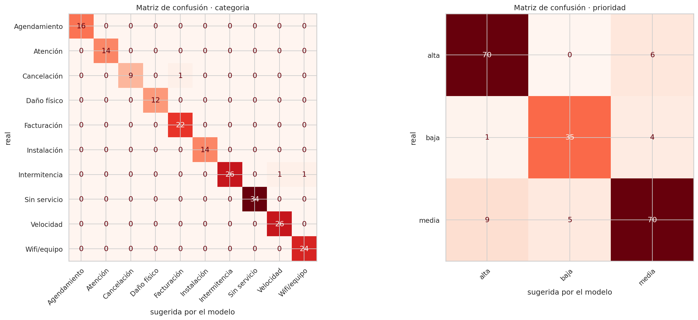
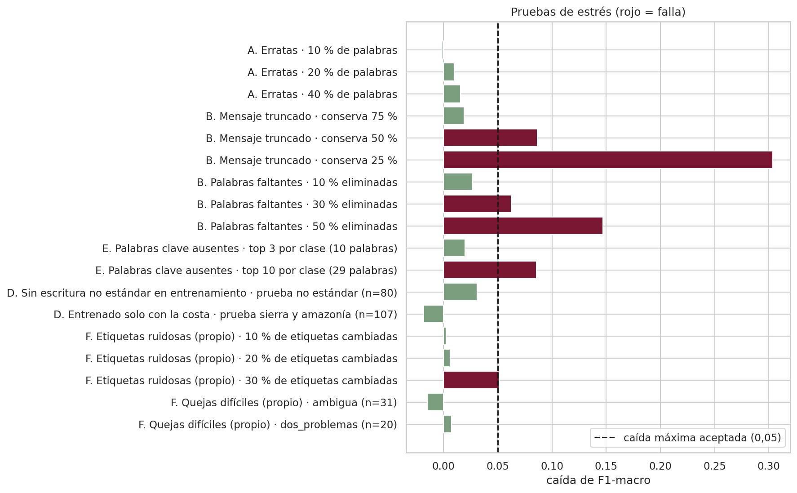

# TriajeIA-ISP


Clasificación asistida de reclamos de clientes de un proveedor de internet en Ecuador. A partir del texto, el sistema
**sugiere la categoría, el área de atención y la prioridad**, muestra por qué y deja a una persona los casos dudosos.
**La herramienta sugiere; la persona decide.**

**Aplicación:** https://triajeia-isp.streamlit.app

> Proyecto final del Proyecto Integrador en Inteligencia Artificial (MIAR0545), Maestría en Inteligencia Artificial,
> Universidad de Especialidades Espíritu Santo (UEES).

## Tabla de contenidos

1. [Problema](#1-problema)
2. [Dataset](#2-dataset)
3. [Metodología](#3-metodología)
4. [Resultados](#4-resultados)
5. [Instalación y uso](#5-instalación-y-uso)
6. [Interfaz de usuario](#6-interfaz-de-usuario)
7. [Estructura del proyecto](#7-estructura-del-proyecto)
8. [Consideraciones éticas](#8-consideraciones-éticas)
9. [Autores y contribuciones](#9-autores-y-contribuciones)
10. [Licencia](#10-licencia)
11. [Agradecimientos y referencias](#11-agradecimientos-y-referencias)
12. [Videos](#12-videos)

## 1. Problema

**¿Qué resuelve?** En un proveedor de internet, cada reclamo llega como texto libre (WhatsApp, llamada transcrita,
correo, redes sociales) y un operador decide en segundos a qué área enviarlo y con qué urgencia. Cuando se equivoca, el
reclamo se **reasigna**: el cliente espera más y el personal repite trabajo.

**¿Por qué es importante?** Una prioridad mal asignada deja más tiempo sin servicio a quien depende de internet para
trabajar, estudiar o por salud. Además, casi toda la evidencia sobre clasificación de tickets está en inglés: el
benchmark público usado en el proyecto tiene solo un 0,9 % de textos en español.

**Usuarios objetivo:** operadores de primer nivel de una mesa de servicio (uso diario) y supervisores (monitoreo).

Detalle: [`docs/planificacion.md`](docs/planificacion.md).

## 2. Dataset

| | |
|---|---|
| Nombre | Corpus sintético de quejas ISP v2 |
| Tamaño | 1.500 quejas: 1.300 de desarrollo y **200 de prueba fija** |
| Etiquetas | Categoría (10) · área de atención (5, deducida de la categoría) · prioridad (alta, media, baja) |
| Idioma | Español de Ecuador: costa, sierra y amazonía; formal, informal, con faltas de ortografía y mezcla con kichwa |
| Origen | **Sintético**: redactado por un modelo de lenguaje (Claude) a partir de especificaciones con las etiquetas fijadas por reglas explícitas |
| Calidad | 0 datos personales · 0 duplicados · 0 casi duplicados entre prueba y entrenamiento |
| Licencia | CC BY 4.0 |
| Archivo | [`data/raw/corpus_quejas_isp_sintetico_v2.csv`](data/raw/corpus_quejas_isp_sintetico_v2.csv) |

Durante las Semanas 2 y 3 también se usó el benchmark público *Classification of IT Support Tickets*
([Zenodo 7384758](https://doi.org/10.5281/zenodo.7384758), CC BY 4.0) como referencia con textos reales.

Detalle: [`data/README.md`](data/README.md) · [`data/guia_etiquetado.md`](data/guia_etiquetado.md) ·
[`docs/analisis_datos.md`](docs/analisis_datos.md).

## 3. Metodología

| Etapa | Decisión |
|---|---|
| **Modelo** | Dos **SVM lineales** sobre TF-IDF de palabras y caracteres, con probabilidades calibradas: una para la categoría y otra para la prioridad. Se comparó con **XLM-RoBERTa** (ajuste fino en GPU): sin diferencia significativa, así que se mantuvo la SVM, más explicable y liviana |
| **Preprocesamiento** | Limpieza mínima (Unicode, enlaces, menciones, espacios), sin corregir la ortografía; los n-gramas de caracteres toleran las erratas. Todo dentro de un *pipeline* para evitar fugas |
| **Optimización** | **Optuna** (TPE, 100 y 50 *trials*) con validación cruzada de 5 *folds*; la configuración optimizada se adopta solo si mejora fuera del margen de error |
| **Métricas** | **F1-macro** (principal), exactitud, precisión y recall por clase, recall de prioridad alta, costo esperado, equidad por subgrupo con n e intervalo de confianza, abstención y curva riesgo–cobertura, latencia |
| **Validación** | Prueba fija usada una sola vez; intervalos *bootstrap*; McNemar; pruebas de estrés en escenarios simulados (erratas, mensajes cortados, palabras faltantes, cambio de población, etiquetas ruidosas) |

Todos los experimentos se ejecutaron en **Google Colab** (GPU Tesla T4). Detalle:
[`docs/arquitectura.md`](docs/arquitectura.md) · [`docs/optimizacion.md`](docs/optimizacion.md) ·
[`docs/evaluacion.md`](docs/evaluacion.md).

## 4. Resultados

Sobre la prueba fija de 200 quejas:

| Métrica | Categoría | Prioridad |
|---|---|---|
| **F1-macro** (IC 95 %) | **0,985** (0,961 – 1,000) | **0,875** (0,824 – 0,922) |
| *Baseline*: clase mayoritaria | 0,029 | 0,197 |
| XLM-RoBERTa | 0,944 (McNemar p = 0,096) | 0,824 (McNemar p = 0,109) |
| Recall de prioridad alta | — | **0,921** (ninguna prioridad alta sugerida como baja) |

| Criterio fijado antes de evaluar | Resultado | ¿Cumple? |
|---|---|---|
| Brecha de F1 entre formas de escribir ≤ 0,10 | 0,044 | ✔ |
| Recall de prioridad alta ≥ 0,90 | 0,921 | ✔ |
| Abstención ≤ 15 % | 12,5 % | ✔ |
| Latencia p95 ≤ 300 ms | 58 ms | ✔ |
| Pruebas de estrés: caída de F1 ≤ 0,05 | 11 de 18 | Parcial: falla con mensajes cortados o con muchas palabras faltantes |

**Optimización:** en la categoría no hubo mejora (+0,000) y se mantuvo la configuración de partida; en la prioridad
sí (+0,010, IC 95 % que no incluye el 0). `C` explica el 79 % – 86 % de la variación.





> **Limitación principal.** El corpus es sintético: las quejas describen el problema con claridad y las etiquetas salen
> de reglas. Con textos reales (benchmark de las Semanas 2 y 3), el F1-macro fue de 0,767 a 0,788. El desempeño con
> reclamos reales de un proveedor **no está medido**.

## 5. Instalación y uso

**Requisitos:** Python 3.11 a 3.13 (scikit-learn 1.6.1 no tiene paquetes precompilados para 3.14) y git.

```bash
git clone https://github.com/jobedon/triajeia-isp.git   # repositorio privado: requiere acceso
cd triajeia-isp
python -m venv .venv && source .venv/bin/activate      # en Windows: .venv\Scripts\activate
pip install -r requirements.txt

pytest -q                                   # 33 pruebas unitarias
ruff check . && ruff format --check .      # estilo PEP 8 (configuración en ruff.toml)
streamlit run app/app.py                    # aplicación en http://localhost:8501
python -m src.train --final                 # reentrenar el modelo (opcional)
```

**Uso desde Python:**

```python
from src.model import ClasificadorTriaje

modelo = ClasificadorTriaje.cargar("models/best_model.joblib")
r = modelo.predecir("desde ayer no tengo internet y trabajo desde la casa")
print(r["categoria"]["etiqueta"], r["area_atencion"], r["prioridad"]["etiqueta"], r["requiere_revision_humana"])
```

**Configuración opcional de la aplicación** (en `.streamlit/secrets.toml`, que no se versiona):

```toml
admin_password = "…"          # activa la pestaña de Monitoreo
db_url = "postgresql://…"     # base PostgreSQL para el registro; sin esto usa SQLite local
ip_sal = "…"                  # clave del código irreversible de la IP
```

**Reproducir los experimentos en Google Colab:** abrir los notebooks `01` a `05` en orden con GPU T4. El repositorio
es privado, así que cada notebook descarga el código con un *token* de solo lectura guardado en los Secretos de Colab
(`GITHUB_TOKEN`) o desde `triajeia-isp.zip` en Google Drive.

## 6. Interfaz de usuario

Aplicación **Streamlit** desplegada en **Streamlit Community Cloud**: https://triajeia-isp.streamlit.app


- **Clasificar:** reclamo escrito o de ejemplo; categoría, área y prioridad con su confianza; términos determinantes;
  distribución de probabilidades; avisos de revisión humana y de confirmación de prioridad; validación del operador.
- **Carga masiva:** CSV de hasta 500 reclamos, con descarga de resultados.
- **Historial:** clasificaciones de la sesión, con gráfico y exportación a CSV.
- **Monitoreo** (con contraseña): indicadores, alertas, gráficos y registro guardado en PostgreSQL.
- **Modelo:** descripción, métricas y limitaciones.
- Diseño adaptable al celular.

Guía paso a paso con capturas: [`docs/manual_usuario.md`](docs/manual_usuario.md).

## 7. Estructura del proyecto

```
triajeia-isp/
├── README.md, LICENSE, requirements.txt, config.yaml
├── docs/        planificación, análisis de datos, arquitectura, optimización, evaluación,
│                consideraciones éticas y manual de usuario
├── data/        corpus v2 (raw/), datos procesados (processed/), guía de etiquetado y scripts de generación
├── notebooks/   01 exploración · 02 preprocesamiento · 03 modelado · 04 optimización · 05 evaluación (ejecutados en Colab)
├── src/         utils · data_processing · model · train · evaluate · registro
├── models/      best_model.joblib (final), model_v1_svm_base.joblib y su ficha
├── app/         aplicación Streamlit (app.py), componentes visuales (estilo.py) y hoja de estilos (assets/)
├── tests/       pruebas unitarias de datos, modelo, aplicación y registro
└── results/     figures/ (figuras de los notebooks), metrics/ (métricas, trials y entorno de cada ejecución) y
                 reports/ (diapositivas del pitch y resumen de una página)
```

## 8. Consideraciones éticas

- **Sesgos:** el corpus refleja las reglas y el estilo del generador; se midió la equidad por forma de escribir,
  región y canal, con n e intervalo de confianza, sin sacar conclusiones de subgrupos con menos de 30 casos.
- **Privacidad:** el entrenamiento no usa datos reales. El registro de la aplicación es opcional, con consentimiento;
  borra cédulas, teléfonos y correos, no guarda la IP (solo un código irreversible) y elimina todo a los 30 días.
- **Transparencia:** modelo interpretable, términos determinantes, probabilidades y límites visibles en la aplicación.
- **Supervisión humana:** abstención bajo el umbral de confianza, aviso para confirmar prioridades bajas y validación
  explícita del operador.
- **Uso no permitido:** decidir cortes, cobros o sanciones, evaluar a los operadores o perfilar clientes.
- **Normativa:** LOPDP y norma de la SPDP sobre IA (2026) revisadas; la evaluación de impacto formal y el uso con datos
  reales requerirían asesoría legal.

Detalle: [`docs/consideraciones_eticas.md`](docs/consideraciones_eticas.md).

## 9. Autores y contribuciones

| Integrante | Rol | Contacto |
|---|---|---|
| **José Olmedo Bedón Sánchez** | *Product Owner*; corpus, etiquetado y línea base | jose.bedon@uees.edu.ec |
| **Javier Isaías Hidalgo Fernández** | Exploración de datos, ajuste fino y servicio | javier.hidalgo@uees.edu.ec |

Docente: Gladys María Villegas Rugel.

## 10. Licencia

Código bajo licencia [MIT](LICENSE). Corpus bajo [CC BY 4.0](https://creativecommons.org/licenses/by/4.0/).

## 11. Agradecimientos y referencias

A la docente Gladys María Villegas Rugel, por la guía y la retroalimentación a lo largo de la materia.

- Benitez Pereira et al., *Classification of IT Support Tickets*, Zenodo, 2022. doi: [10.5281/zenodo.7384758](https://doi.org/10.5281/zenodo.7384758).
- A. Conneau et al., «Unsupervised Cross-lingual Representation Learning at Scale», *ACL*, 2020 (XLM-RoBERTa).
- F. Pedregosa et al., «Scikit-learn: Machine Learning in Python», *JMLR*, vol. 12, 2011.
- T. Akiba et al., «Optuna: A Next-generation Hyperparameter Optimization Framework», *KDD*, 2019.
- S. Bird et al., «Fairlearn: A toolkit for assessing and improving fairness in AI», Microsoft, 2020.
- T. G. Dietterich, «Approximate Statistical Tests for Comparing Supervised Classification Learning Algorithms», *Neural Computation*, 1998 (McNemar).
- M. Mitchell et al., «Model Cards for Model Reporting», *FAT\**, 2019 · T. Gebru et al., «Datasheets for Datasets», *CACM*, 2021.
- Ley Orgánica de Protección de Datos Personales (Ecuador), 2021 · Superintendencia de Protección de Datos Personales, Res. SPDP-SPD-2026-0009-R, 2026.

## 12. Videos

- **Video pitch (5 minutos):** *pendiente*
- **Video de respuestas a las preguntas:** *pendiente*
