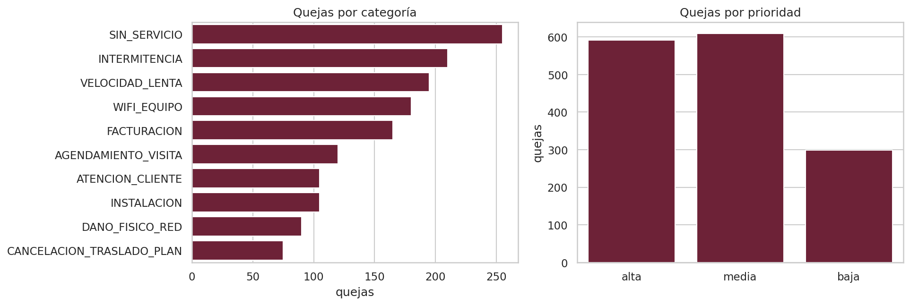
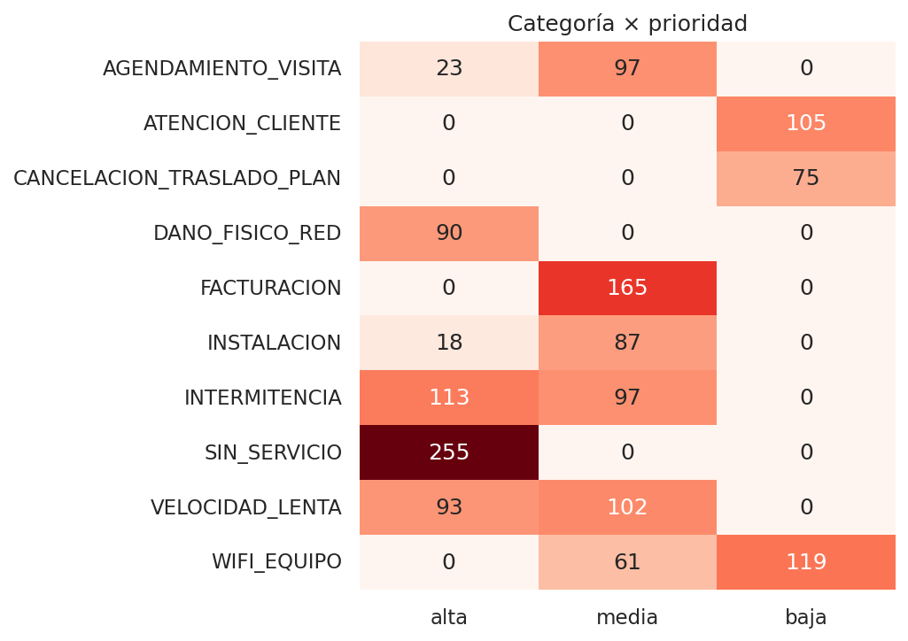
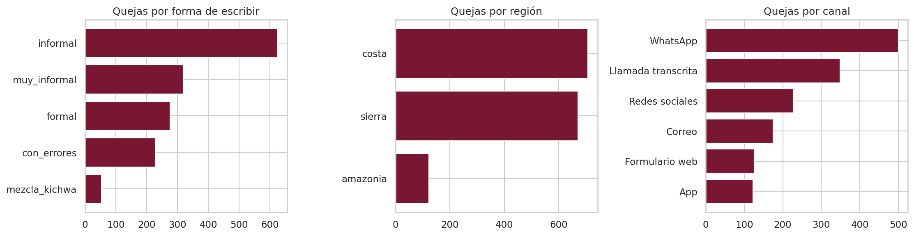
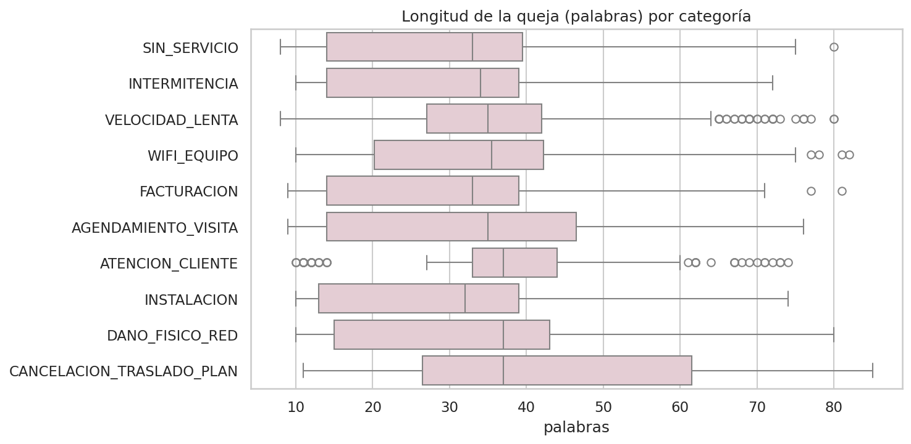
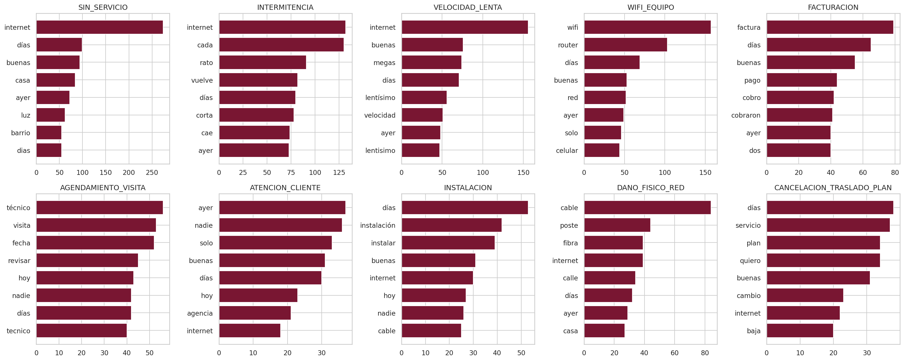
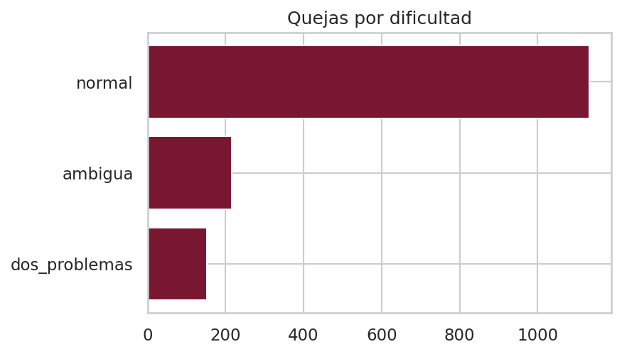
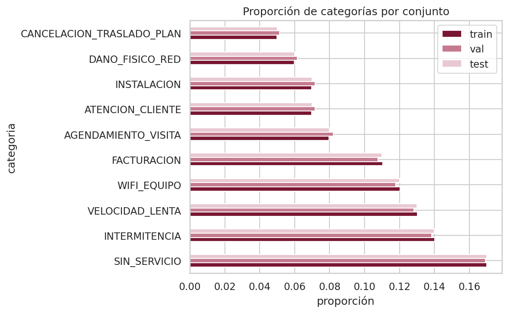

# Análisis de datos

Análisis exploratorio del corpus usado para entrenar y evaluar TriajeIA-ISP. Las cifras y figuras provienen de
[`notebooks/01_exploracion.ipynb`](../notebooks/01_exploracion.ipynb) y
[`notebooks/02_preprocesamiento.ipynb`](../notebooks/02_preprocesamiento.ipynb), ejecutados en Google Colab el
20/10/2026, y del control de calidad del corpus ([`data/generacion/reporte_validacion.md`](../data/generacion/reporte_validacion.md)).

## 1. Descripción del dataset

| Campo | Detalle |
|---|---|
| Nombre | Corpus sintético de quejas ISP v2 |
| Archivo | [`data/raw/corpus_quejas_isp_sintetico_v2.csv`](../data/raw/corpus_quejas_isp_sintetico_v2.csv) |
| Tamaño | **1.500 quejas**: 1.300 de entrenamiento y desarrollo, 200 de prueba fija |
| Idioma | Español de Ecuador, con jerga de la costa, la sierra y la amazonía, faltas de ortografía y mezcla ocasional con palabras kichwa |
| Licencia | CC BY 4.0 |
| Origen | **Sintético**: generado con el modelo de lenguaje Claude a partir de especificaciones con las etiquetas fijadas de antemano (ver sección 2) |
| Datos personales | Ninguno (verificado: 0 cédulas, teléfonos, correos o números de cuenta) |

**Variables.**

| Variable | Tipo | Valores |
|---|---|---|
| `queja` | Texto | Entre 8 y 85 palabras (mediana 34) |
| `categoria` | Etiqueta (objetivo) | 10 categorías |
| `prioridad` | Etiqueta (objetivo) | alta, media, baja |
| `area_atencion` | Etiqueta derivada | 5 áreas, deducidas de la categoría |
| `motivo_prioridad` | Auxiliar | La regla que fijó la prioridad |
| `registro` | Subgrupo | formal, informal, muy_informal, con_errores, mezcla_kichwa |
| `region`, `ciudad`, `canal` | Subgrupo | 3 regiones, 33 ciudades, 6 canales |
| `dificultad`, `categoria_secundaria` | Subgrupo | normal, ambigua, dos_problemas |
| `conjunto` | Partición | entrenamiento, prueba |

Las variables de subgrupo **no son entradas del modelo**: el modelo solo lee el texto. Sirven para evaluar si funciona
igual para todos (ver [`evaluacion.md`](evaluacion.md)).

## 2. Por qué un corpus sintético y cómo se construyó

El proyecto no podía usar reclamos reales de clientes: son datos personales y confidenciales de una empresa. Se
generaron quejas sintéticas en dos versiones:

| | Corpus v1 (descartado, no publicado) | Corpus v2 (el que se usa) |
|---|---|---|
| Tamaño | 1.000 | 1.500 |
| Construcción | Generado por el equipo con Claude, tomando como referencia de temas y estilo un extracto interno de registros de soporte, que no se publica | Seis redactores independientes (instancias de Claude) escriben cada queja a partir de una especificación; un redactor distinto y aislado escribe la prueba |
| Oraciones que se repiten 5 o más veces | 67,8 % | 9,1 % (casi todas son saludos) |
| Quejas con una palabra exclusiva de su categoría | 61,5 % | 16,5 % |
| Categorías con una sola prioridad posible | 7 de 10 | 5 de 10, por definición |
| Distribución por categoría | 100 exactas por categoría | Desigual, como en una operación real |
| Área de atención | No existía | Incluida |

El v1 se descartó porque estaba armado con frases fijas: un modelo podía acertar reconociendo frases sin entender el
reclamo. Además, su regla de prioridad premiaba a los negocios («tengo un negocio» siempre era alta) y no consideraba a
las personas vulnerables. Las reglas del v2 están en [`data/guia_etiquetado.md`](../data/guia_etiquetado.md).

## 3. Estadísticas descriptivas

| Indicador | Valor |
|---|---|
| Quejas | 1.500 (sin valores vacíos ni duplicados exactos) |
| Palabras por queja | media 35,2 · desviación 18,6 · mínimo 8 · mediana 34 · máximo 85 |
| Longitud según la especificación | cortas 390 (media 12,3 palabras) · medias 818 (35,0) · largas 292 (66,4) |
| Razón de desbalance de categorías | **3,4 : 1** (sin servicio 255 frente a cancelación 75) |
| Prioridad | alta 592 (39 %) · media 609 (41 %) · baja 299 (20 %) |
| Forma de escribir | informal 625 · muy informal 318 · formal 276 · con errores 228 · mezcla con kichwa 53 |
| Región | costa 707 · sierra 670 · amazonía 123 |
| Canal | WhatsApp 500 · llamada transcrita 349 · redes sociales 227 · correo 175 · formulario web 126 · app 123 |
| Dificultad | normal 1.133 · ambigua 215 · con dos problemas 152 |

## 4. Visualizaciones

### 4.1 Distribución de las etiquetas

Las categorías técnicas (sin servicio, intermitencia, velocidad lenta, wifi) son las más frecuentes, como en un
servicio de internet real. La prioridad baja es la clase minoritaria (20 %).

### 4.2 Relación entre categoría y prioridad

| Categoría | Alta | Media | Baja |
|---|---|---|---|
| Sin servicio | 255 | 0 | 0 |
| Daño físico de la red | 90 | 0 | 0 |
| Intermitencia | 113 | 97 | 0 |
| Velocidad lenta | 93 | 102 | 0 |
| Agendamiento de visita | 23 | 97 | 0 |
| Instalación | 18 | 87 | 0 |
| Facturación | 0 | 165 | 0 |
| Wifi / equipo | 0 | 61 | 119 |
| Atención al cliente | 0 | 0 | 105 |
| Cancelación / traslado / plan | 0 | 0 | 75 |

Es la **correlación más fuerte del dataset**, y es intencional: según la guía de etiquetado, sin servicio y daño
físico son siempre prioridad alta, y atención al cliente y cancelación siempre baja. En las otras cinco categorías, la
prioridad depende de hechos que aparecen en el texto: dependencia crítica del servicio (negocio, teletrabajo, salud),
5 o más días con el problema o un reclamo previo sin solución. Por eso la prioridad es la tarea más difícil del modelo.

### 4.3 Subgrupos

Cuántas quejas de cada subgrupo hay en la **prueba** (200):

| Forma de escribir | n | Región | n | Canal | n |
|---|---|---|---|---|---|
| Informal | 89 | Costa | 93 | WhatsApp | 64 |
| Muy informal | 43 | Sierra | 93 | Llamada transcrita | 45 |
| Con errores | 32 | Amazonía | **14** | Redes sociales | 27 |
| Formal | 31 | | | Correo | 25 |
| Mezcla con kichwa | **5** | | | Formulario web | 21 |
| | | | | App | 18 |

Los subgrupos con menos de 30 casos se reportan con su intervalo de confianza, sin sacar conclusiones de ellos por
separado.

### 4.4 Longitud por categoría

La longitud es parecida en todas las categorías, porque se asignó al azar en la especificación. Así el modelo no puede
adivinar la categoría por el largo del mensaje.

### 4.5 Vocabulario por categoría

Las palabras más frecuentes son las propias de cada tema («factura», «técnico», «visita», «cable», «wifi», «router»).
En el v2, solo el 16,5 % de las quejas contiene una palabra exclusiva de su categoría que aparezca 10 o más veces, y
esas palabras son naturales del tema («comprobante», «inalámbrica», «test»), no frases de plantilla.

### 4.6 Dificultad

El 24,5 % de las quejas son difíciles a propósito: 215 ambiguas (sus síntomas se parecen a los de otra categoría) y 152
con dos problemas (la etiqueta es el problema principal).

### 4.7 Estratificación de los conjuntos

Entrenamiento, validación y prueba mantienen las mismas proporciones de categorías.

## 5. Patrones, correlaciones y valores atípicos

- **Correlación categoría–prioridad:** descrita en 4.2. Es parte del diseño y está documentada.
- **Subgrupos independientes de la etiqueta:** la forma de escribir, la región, el canal y la longitud se asignaron al
  azar, sin relación con la categoría. Así se puede medir la equidad sin que un subgrupo «delate» la etiqueta.
- **Valores atípicos:** no hay textos vacíos ni anormalmente largos (máximo 85 palabras). Las quejas más cortas
  (8 palabras) son intencionales: representan mensajes breves, que en la realidad son frecuentes.
- **Calidad:** 0 datos personales, 0 duplicados exactos, 0 casi duplicados entre prueba y entrenamiento; ninguna
  queja fuera del rango de longitud pedido (±30 %).

## 6. Decisiones de preprocesamiento

| Decisión | Justificación |
|---|---|
| **Limpieza mínima** (`src/data_processing.limpiar_texto`): normalización Unicode, enlaces → `<url>`, menciones → `@isp`, espacios compactados. Modificó 226 de 1.500 textos | La forma de escribir es parte de lo que el modelo debe tolerar; corregir la ortografía o quitar tildes ocultaría ese problema |
| **Sin eliminar palabras vacías ni lematizar** | Los n-gramas de palabras necesitan expresiones como «desde hace», clave para la prioridad |
| **Minúsculas y n-gramas de caracteres** dentro del vectorizador | Toleran errores como «buelve» o «nesesito» sin modificar el texto guardado |
| **Prueba fija de 200 quejas**, estratificada por categoría y escrita por otro redactor | Evitar que el modelo apruebe por reconocer el estilo de quien escribió el entrenamiento |
| **Validación** = 15 % del entrenamiento (195), estratificada por categoría; entrenamiento 1.105 | Ajustar modelos sin tocar la prueba |
| **Todo dentro de un *pipeline*** de scikit-learn | El vectorizador se ajusta solo con entrenamiento: no hay fuga de información |
| **Control de fuga** antes de dividir | La queja de prueba más parecida a una de entrenamiento comparte como máximo 0,43 de sus fragmentos de 4 palabras |

## 7. Datos faltantes y desbalance

- **Faltantes:** no hay valores vacíos en ninguna columna.
- **Desbalance:** moderado en las categorías (3,4 : 1) y en la prioridad (baja 20 %). Se maneja con:
  - **F1-macro** como métrica principal, que pesa igual a todas las clases;
  - `class_weight="balanced"` en la SVM, que da más peso a los errores en las clases pequeñas;
  - evaluación por clase con su número de casos.

## 8. Dataset de referencia: benchmark público (tarea A)

En las Semanas 2 y 3 el proyecto trabajó con un benchmark público, *Classification of IT Support Tickets*
(Zenodo 7384758, CC BY 4.0), para tener una línea base reproducible con textos reales. Su análisis mostró problemas
que confirmaron la necesidad de un corpus propio del dominio:

- 1.572 tickets de entrenamiento con solo **962 textos únicos** (39 % de duplicados);
- 125 de 657 tickets de prueba (19 %) idénticos a alguno de entrenamiento;
- **87,0 % en inglés y solo 0,9 % en español**;
- desbalance de **12,1 : 1** y una clase (EOL) con apenas 2 textos únicos;
- 7 categorías de soporte de TI corporativo, sin ninguna relación con los reclamos de un proveedor de internet.

En ese benchmark, la SVM obtuvo 0,767 de F1-macro y XLM-RoBERTa 0,788 en la prueba sin duplicados, sin diferencia
significativa (McNemar p = 0,91). Esas cifras recuerdan que con textos reales el desempeño es mucho menor que con el
corpus sintético.

## 9. Limitaciones del dataset

- **Sintético:** el texto lo redactó un modelo de lenguaje y las etiquetas salen de reglas, sin anotadores humanos
  (no hay κ de Cohen). Un buen resultado sobre este corpus no garantiza el mismo desempeño con reclamos reales.
- Las proporciones de categorías, regiones, canales y formas de escribir son un **supuesto** del equipo.
- Algunos barrios mencionados pueden no corresponder exactamente a la ciudad indicada.
- La etiqueta `registro = mezcla_kichwa` existe solo para evaluar la equidad; en un sistema real no se infiere ni se
  guarda, porque puede revelar el origen étnico.
