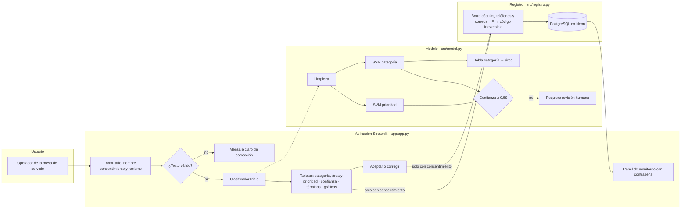
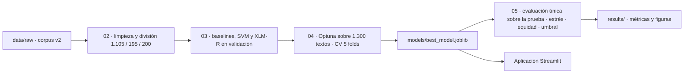

# Arquitectura

## 1. Modelo seleccionado y justificación

**Modelo en producción:** dos clasificadores **SVM lineales sobre TF-IDF de palabras y de caracteres, con
probabilidades calibradas**: uno para la categoría (10 clases) y otro para la prioridad (3 clases). El área de atención
se obtiene de la categoría con una tabla fija.

| Criterio | SVM lineal (elegida) | XLM-RoBERTa (evaluada) |
|---|---|---|
| F1-macro en la prueba: categoría / prioridad | 0,985 / 0,875 | 0,944 / 0,824 |
| Diferencia significativa (McNemar, α = 0,05) | — | No (p = 0,096 y p = 0,109) |
| Explicación de cada predicción | Directa: peso de cada palabra | Requiere técnicas adicionales (LIME, SHAP) |
| Tamaño del modelo | 29 MB (ambos clasificadores) | ~1 GB por clasificador |
| Hardware | CPU: 62 ms por queja (p95) | GPU para entrenar; inferencia lenta en CPU |
| Despliegue en Streamlit Community Cloud | Sí | Difícil por memoria |

**Regla de decisión** (fijada en la Semana 4): *un modelo más costoso solo reemplaza a la SVM si la supera con
significancia estadística; ante un empate se queda la SVM, más explicable y liviana*. XLM-R no la superó, así que se
mantiene la SVM. El detalle está en [`evaluacion.md`](evaluacion.md).

**Por qué no un modelo para el área:** el área depende solo de la categoría. Entrenar un tercer modelo agregaría
errores sin aportar información; una tabla es más simple, exacta y auditable.

## 2. Arquitectura detallada del modelo

```
Texto de la queja
   │  limpieza mínima (Unicode, <url>, @isp, espacios)
   ▼
FeatureUnion ─┬─ TF-IDF de palabras    (n-gramas de 1–2 en categoría, 1–3 en prioridad)
              └─ TF-IDF de caracteres  (fragmentos de 3–5 en categoría, 2–6 en prioridad, por palabra)
   ▼
LinearSVC (class_weight = balanced, C = 0,3 en categoría · 7,92 en prioridad)
   ▼
Calibración sigmoide (CalibratedClassifierCV, 5 folds) → probabilidad por clase
```

| Parámetro | Categoría | Prioridad |
|---|---|---|
| Vocabulario de palabras (n-gramas) | 19.628 | 48.394 |
| Fragmentos de caracteres | 21.683 | 33.582 |
| **Total de rasgos** | **41.311** | **81.976** |
| `C` | 0,3 | 7,92 |
| `sublinear_tf` | sí | no |
| `min_df` | 1 | 1 |
| Clases | 10 categorías | alta, baja, media |

Los valores de `C` y de los n-gramas salen de la optimización ([`optimizacion.md`](optimizacion.md)); la configuración
está en [`config.yaml`](../config.yaml) y [`results/metrics/mejores_params_svm.json`](../results/metrics/mejores_params_svm.json).
Ambos clasificadores se entrenaron con los 1.300 textos de desarrollo.

**Capa de decisión** (`ClasificadorTriaje` en [`src/model.py`](../src/model.py)):

| Regla | Valor | Origen |
|---|---|---|
| Umbral de abstención | Si la confianza de la categoría **o** de la prioridad es menor que **0,59**, la queja se marca «requiere revisión humana» | Elegido con datos de desarrollo para que la abstención sea ≤ 15 % |
| Alerta de prioridad | Si la prioridad sugerida no es alta pero P(alta) ≥ 0,20, la interfaz pide confirmarla | Asimetría de la Semana 4: bajar una prioridad exige confirmación humana |
| Términos determinantes | Las 5 palabras del texto con mayor aporte a la categoría sugerida (peso de la SVM × TF-IDF), sin palabras vacías | Transparencia de cada predicción |

**XLM-RoBERTa (evaluado, no desplegado):** `FacebookAI/xlm-roberta-base` con ajuste fino completo, longitud máxima de
128 *tokens*, lotes de 16, tasa de aprendizaje 2e-5, *weight decay* 0,01, *dropout* 0,1, hasta 15 épocas con parada
temprana por F1-macro de validación (paciencia 3) y precisión mixta en GPU T4.

## 3. Diagrama del sistema completo



**Flujo de entrenamiento** (notebooks en Google Colab):



## 4. Pipeline de datos: de la entrada a la salida

| Paso | Componente | Entrada → salida |
|---|---|---|
| 1. Captura | `app/app.py` | Texto escrito o pegado por el operador (máx. 2.000 caracteres), o un CSV de hasta 500 filas |
| 2. Validación | `src/data_processing.validar_entrada` | Rechaza textos vacíos, sin letras, de menos de 3 palabras o demasiado largos, con un mensaje en lenguaje claro |
| 3. Limpieza | `src/data_processing.limpiar_texto` | Texto normalizado, sin modificar la ortografía |
| 4. Representación | `FeatureUnion` de TF-IDF | Vector disperso de 41.311 (categoría) y 81.976 (prioridad) rasgos |
| 5. Clasificación | SVM calibradas | Distribución de probabilidad por clase |
| 6. Decisión | `ClasificadorTriaje.predecir` | Etiquetas, área, marca de revisión humana y términos determinantes |
| 7. Presentación | Interfaz | Tarjetas, avisos, gráficos de probabilidades y validación del operador |
| 8. Registro (opcional) | `src/registro.py` | Solo con consentimiento: mensaje anonimizado, código de IP, sugerencia y decisión → PostgreSQL. Se borra a los 30 días |
| 9. Monitoreo | Pestaña «Monitoreo» | Indicadores, alertas y gráficos sobre el registro |

**Formato de la salida del modelo:**

```json
{
  "categoria": {"etiqueta": "SIN_SERVICIO", "probabilidad": 0.98, "distribucion": {"SIN_SERVICIO": 0.98, "...": 0.0}},
  "prioridad": {"etiqueta": "alta", "probabilidad": 0.99, "distribucion": {"alta": 0.99, "media": 0.01, "baja": 0.0}},
  "area_atencion": "SOPORTE_TECNICO",
  "requiere_revision_humana": false,
  "terminos_influyentes": ["internet", "casa", "reporte"]
}
```

## 5. Estructura del código

| Módulo | Responsabilidad |
|---|---|
| `src/utils.py` | Configuración (`config.yaml`), rutas relativas, semillas, *logging*, JSON |
| `src/data_processing.py` | Carga y validación del corpus, limpieza, validación de entradas, división sin fuga |
| `src/model.py` | Construcción de la SVM, términos determinantes y `ClasificadorTriaje` (predicción, guardado y carga) |
| `src/train.py` | Entrenamiento por línea de comandos (`python -m src.train`) |
| `src/evaluate.py` | Métricas, intervalos *bootstrap*, McNemar, subgrupos, riesgo–cobertura, costo y perturbaciones de estrés |
| `src/registro.py` | Base de datos (SQLite o PostgreSQL), anonimización, código de IP, decisiones y retención |
| `app/app.py`, `app/estilo.py`, `app/assets/estilo.css` | Interfaz Streamlit, componentes visuales y hoja de estilos |
| `tests/` | 36 pruebas unitarias (`pytest`) |

## 6. Tecnologías y versiones

| Uso | Tecnología | Versión |
|---|---|---|
| Lenguaje | Python | 3.13.15 en Colab · 3.11 o superior en local · 3.11 a 3.13 en Streamlit Cloud (la 3.14 no tiene scikit-learn 1.6.1 precompilado) |
| Modelo | scikit-learn | **1.6.1** (la misma en entrenamiento y despliegue, necesaria para cargar el modelo) |
| Datos | pandas · NumPy · SciPy | 2.2.3 · 2.1.3 · 1.17.1 |
| Optimización | Optuna | 5.0.0 (`requirements.txt`) |
| Equidad | Fairlearn | 0.15.0 (`requirements.txt`) |
| Transformer | PyTorch · Hugging Face Transformers | 2.11.0 (Colab) · versión instalada en Colab |
| Interfaz | Streamlit · Plotly | 1.66.0 · 7.1.0 |
| Base de datos | SQLAlchemy · psycopg · PostgreSQL (Neon) | 2.0.55 · 3.3.6 · servicio gestionado |
| Pruebas | pytest | 9.1.1 |
| Estilo del código (PEP 8) | ruff | 0.17.1 |
| Entorno de cómputo | Google Colab (GPU Tesla T4) · Streamlit Community Cloud | — |

Las versiones exactas de cada ejecución en Colab quedaron registradas en `results/metrics/entorno_0*.json`. En Colab,
Optuna y Fairlearn se instalaron con `pip install optuna>=4 fairlearn>=0.12`, por lo que su versión exacta en esa
ejecución no quedó registrada.

## 7. Despliegue

| Componente | Dónde |
|---|---|
| Aplicación | Streamlit Community Cloud, desde la rama `main` · https://triajeia-isp.streamlit.app |
| Base de datos del registro | PostgreSQL en Neon (secreto `db_url`) |
| Secretos | `admin_password`, `db_url` e `ip_sal`, en la configuración de Streamlit; nunca en el repositorio |
| Configuración de la interfaz | `.streamlit/config.toml` (tema, tamaño máximo de carga, sin estadísticas de uso) |

Al subir cambios a `main`, Streamlit actualiza la aplicación. Si cambian módulos de `src/`, `app/estilo.py` o `app/assets/`, hay que
reiniciarla (*Reboot app*), porque Python no recarga los módulos ya importados.
