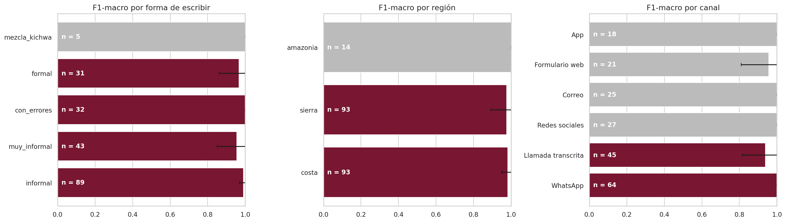
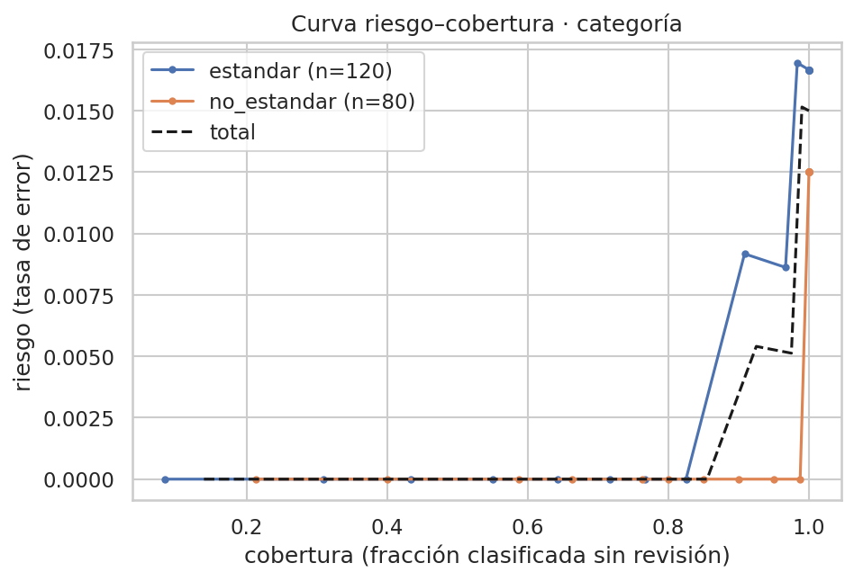

# Evaluación del modelo

Este documento sigue la estructura de la fase de evaluación vista en la Semana 5: para cada aspecto se presenta
**la decisión tomada, la evidencia que la respalda y las limitaciones que se reconocen**.

- **Modelo evaluado:** `models/best_model.joblib` (versión `v2_svm_final`): dos SVM lineales calibradas, una para la
  categoría y otra para la prioridad; el área se deduce de la categoría con una tabla.
- **Datos:** prueba fija de **200 quejas** del corpus sintético v2, usada **una sola vez** en
  [`notebooks/05_evaluacion.ipynb`](../notebooks/05_evaluacion.ipynb).
- **Origen de las cifras:** ejecución en Google Colab (GPU Tesla T4, Python 3.13, scikit-learn 1.6.1) del 20/10/2026;
  todas están en [`results/metrics/05_evaluacion.json`](../results/metrics/05_evaluacion.json).

## Resumen

| Indicador | Resultado | Criterio | ¿Cumple? |
|---|---|---|---|
| F1-macro categoría | **0,985** (IC 95 % 0,961 – 1,000) | ≥ 0,70 (Documento de Alcance, tarea B) | Sí |
| F1-macro prioridad | **0,875** (IC 95 % 0,824 – 0,922) | — | — |
| Recall de prioridad alta | **0,921** | ≥ 0,90 (compromiso ético, Semana 4) | Sí |
| Prioridad alta clasificada como baja | **0 de 76** | Error más grave | — |
| Brecha de F1 entre formas de escribir (n ≥ 30) | **0,044** | ≤ 0,10 (Semana 4) | Sí |
| Abstención (revisión humana) | **12,5 %** | ≤ 15 % (Documento de Alcance) | Sí |
| Latencia p95 por queja | **58 ms** | ≤ 300 ms | Sí |
| Pruebas de estrés superadas | **11 de 18** | Caída de F1 ≤ 0,05 | Parcial |

> **Advertencia principal.** El corpus es sintético: las quejas describen el problema con claridad y las etiquetas
> salen de reglas explícitas. Por eso la categoría queda casi perfecta. Estos resultados muestran que el modelo
> aprende bien las reglas y el estilo del corpus; **no garantizan el mismo desempeño con reclamos reales**.

---

## 1. Métricas básicas

**Decisión.** La métrica principal es el **F1-macro**, que pesa igual a todas las clases; la exactitud se reporta
solo como referencia. Se compara siempre contra un *baseline* que predice la clase más frecuente.

**Evidencia.**

| Objetivo | F1-macro | Exactitud | Precisión macro | Recall macro | *Baseline* (clase mayoritaria) |
|---|---|---|---|---|---|
| Categoría (10 clases) | 0,985 | 0,985 | 0,988 | 0,983 | 0,029 |
| Prioridad (3 clases) | 0,875 | 0,875 | 0,875 | 0,876 | 0,197 |

F1 por clase en la prueba (n = número de casos):

| Categoría | F1 | n | Categoría | F1 | n |
|---|---|---|---|---|---|
| Sin servicio | 1,000 | 34 | Agendamiento de visita | 1,000 | 16 |
| Intermitencia | 0,963 | 28 | Instalación | 1,000 | 14 |
| Velocidad lenta | 0,981 | 26 | Atención al cliente | 1,000 | 14 |
| Wifi / equipo | 0,980 | 24 | Daño físico de la red | 1,000 | 12 |
| Facturación | 0,978 | 22 | Cancelación / traslado / plan | 0,947 | 10 |

| Prioridad | F1 | n |
|---|---|---|
| Alta | 0,897 | 76 |
| Media | 0,854 | 84 |
| Baja | 0,875 | 40 |

**Limitaciones.** Con 10 a 34 casos por categoría, un solo error mueve el F1 de una clase varios puntos. La sección
C de las pruebas de estrés muestra por qué no se usa la exactitud como métrica principal.

## 2. Evaluación estadística robusta

**Decisión.** Toda cifra se acompaña de su intervalo de confianza; una diferencia que cae dentro del intervalo **no
se considera mejora**. Para comparar modelos sobre las mismas quejas se usa la prueba de McNemar (α = 0,05) y el
intervalo *bootstrap* de la diferencia.

**Evidencia.**

- **Intervalos *bootstrap*** (2.000 remuestreos) en la prueba: categoría 0,985 [0,961; 1,000]; prioridad 0,875
  [0,824; 0,922].
- **Validación cruzada repetida 5 × 3** sobre los 1.300 textos de desarrollo (notebook 04): categoría 0,987 ± 0,007;
  prioridad 0,873 ± 0,014 con la configuración final.
- **SVM frente a XLM-RoBERTa** (ajuste fino en Colab, notebook 03; sus predicciones sobre la prueba se guardaron sin
  mirarlas y se abrieron una sola vez aquí):

| Objetivo | SVM | XLM-R | McNemar | Diferencia SVM − XLM-R (IC 95 %) |
|---|---|---|---|---|
| Categoría | 0,985 | 0,944 | p = 0,096 | +0,041 [+0,002; +0,086] |
| Prioridad | 0,875 | 0,824 | p = 0,109 | +0,052 [−0,005; +0,112] |

La SVM obtiene cifras más altas, pero **McNemar no muestra diferencia significativa** en ninguno de los dos
objetivos. Según la regla fijada en la Semana 4 (*XLM-R solo reemplaza a la SVM si la supera con significancia; ante
un empate se queda la SVM, más explicable y liviana*), se mantiene la SVM. En validación (notebook 03) el resultado
fue el mismo: categoría p = 1,000 y prioridad p = 0,424.

**Limitaciones.** XLM-R se entrenó con una sola semilla y sin búsqueda de hiperparámetros (cada corrida tarda 2 a 3
minutos en la T4). En la categoría, el intervalo *bootstrap* de la diferencia apenas excluye el 0 mientras McNemar no
es significativo: se informa como evidencia débil a favor de la SVM, no como superioridad demostrada.

## 3. Métricas del dominio

**Decisión.** En el triaje no todos los errores cuestan lo mismo: bajar la prioridad de una avería deja a alguien sin
servicio más tiempo. Se mide el **recall de prioridad alta** y un **costo esperado** con esta matriz (supuesto del
equipo, en unidades relativas):

| Real → sugerida | Costo |
|---|---|
| Alta → baja | 10 |
| Alta → media | 5 |
| Media → baja | 3 |
| Baja → alta | 2 |
| Media → alta · Baja → media | 1 |

**Evidencia.**

- **Recall de prioridad alta: 0,921** (70 de 76), por encima del mínimo de 0,90.
- **Ninguna prioridad alta se sugirió como baja**; los 6 errores de prioridad alta se sugirieron como media.
- **Costo esperado: 0,30 por queja**, frente a 2,10 si se asignara siempre «media».
- Los errores más frecuentes van **hacia arriba** (9 quejas de prioridad media sugeridas como alta), que es la
  dirección menos dañina.

**Limitaciones.** Los costos son un supuesto; con datos reales deberían definirse con la operación.

## 4. Diagnóstico de sobreajuste y subajuste

**Decisión.** Se compara el F1 en entrenamiento y en validación (notebook 03) y se revisa la variación entre *folds*.

**Evidencia.**

| Objetivo | F1 entrenamiento | F1 validación | Brecha | Diagnóstico |
|---|---|---|---|---|
| Categoría | 1,000 | 0,996 | 0,004 | Ajuste adecuado |
| Prioridad | 0,998 | 0,863 | 0,135 | **Varianza alta**: el modelo memoriza parte del entrenamiento |

En la prioridad, la optimización eligió un C mayor (7,9) y aun así mejoró la validación cruzada (de 0,864 a 0,873,
ver [`optimizacion.md`](optimizacion.md)), lo que indica que el límite está en la dificultad de la tarea y no en la
regularización. En XLM-R, la parada temprana por F1-macro de validación (lección de la Semana 3) detuvo el
entrenamiento en la época 8 (categoría, mejor época 5) y 7 (prioridad, mejor época 4).

**Limitaciones.** La prioridad depende de detalles del texto (días con el problema, reclamos previos, dependencia
crítica) que a veces se expresan de forma indirecta; más datos de esos casos reducirían la varianza.

## 5. Detección y mitigación de sesgo

**Decisión.** Se mide el F1 por subgrupo con su **número de casos (n) e intervalo de confianza**. Siguiendo la
retroalimentación de la Semana 4: **con n < 30 el valor se reporta, pero no se usa para concluir**, y los grupos
pequeños se agregan («escritura no estándar» = muy informal + con errores + mezcla con kichwa). Criterio fijado antes
de evaluar: brecha ≤ 0,10 entre subgrupos con n ≥ 30.

**Evidencia (categoría).**

| Forma de escribir | n | F1 | IC 95 % | ¿Concluyente? |
|---|---|---|---|---|
| Informal | 89 | 0,991 | 0,970 – 1,000 | Sí |
| Muy informal | 43 | 0,956 | 0,852 – 1,000 | Sí |
| Con errores | 32 | 1,000 | 1,000 – 1,000 | Sí |
| Formal | 31 | 0,968 | 0,861 – 1,000 | Sí |
| Mezcla con kichwa | 5 | 1,000 | — | **No** (n < 30) |
| *Agregado:* escritura estándar / no estándar | 120 / 80 | 0,987 / 0,981 | — | Sí |

| Subgrupo | Brecha entre grupos con n ≥ 30 | ¿Cumple ≤ 0,10? |
|---|---|---|
| Forma de escribir | 0,044 | Sí |
| Escritura estándar frente a no estándar | 0,006 | Sí |
| Región (costa 93, sierra 93; amazonía 14 sin conclusión) | 0,006 | Sí |
| Canal (WhatsApp 64, llamada transcrita 45; el resto con n < 30) | 0,061 | Sí |

- **Igualdad de oportunidad en la prioridad** (`fairlearn.MetricFrame`): recall de prioridad alta 0,920 con escritura
  estándar y 0,923 con no estándar (diferencia 0,003).
- **Abstención por subgrupo** (ver sección 8): el modelo duda **más** con las quejas **formales** (22,6 %) que con las
  que tienen errores (6,2 %). La abstención no está ocultando un peor trato a quien escribe con faltas.

**Limitaciones.** Los intervalos de los grupos de 31 a 45 casos son anchos (por ejemplo, 0,852 – 1,000). El subgrupo
«mezcla con kichwa» es un atributo de diseño del corpus sintético, usado **solo** para evaluar la equidad: no es una
entrada del modelo y en un sistema real no se infiere ni se guarda, porque puede revelar el origen étnico
(ver [`consideraciones_eticas.md`](consideraciones_eticas.md)).

## 6. Problemas de generalización

**Decisión.** Prevenir la fuga de información y medir qué pasa cuando cambia la población.

**Evidencia.**

- **Prueba fija** de 200 quejas, escrita por un redactor distinto al del entrenamiento y estratificada por categoría.
- **Sin duplicados** y sin copias entre conjuntos: la queja de prueba más parecida a una de entrenamiento comparte como
  máximo 0,43 de sus fragmentos de 4 palabras (Jaccard; notebook 02).
- Todo el preprocesamiento vive dentro del *pipeline*, que se ajusta solo con entrenamiento.
- **Cambio de población** (escenario D, sección 8): entrenar sin la escritura no estándar baja el F1 en esas quejas de
  0,981 a 0,950 (caída 0,031); entrenar solo con quejas de la costa no empeora en la sierra y la amazonía.

**Limitaciones.** Todas las quejas comparten el mismo origen sintético, así que estas pruebas no miden la caída al
pasar a reclamos reales, que sigue siendo el riesgo principal. El benchmark público de la tarea A (Semanas 2 y 3:
SVM 0,767 y XLM-R 0,788 de F1-macro en su prueba limpia) muestra que con textos reales las cifras son mucho más bajas.

## 7. Optimización de hiperparámetros

**Decisión.** Búsqueda bayesiana con Optuna sobre la SVM; se adopta la configuración optimizada **solo si** mejora la
validación cruzada fuera del margen de error.

**Evidencia.** En la categoría no hubo mejora (+0,000, IC [−0,002; +0,002]) y se mantuvo la configuración de partida;
en la prioridad sí (+0,010, IC [+0,004; +0,016]) y se adoptó la optimizada. Detalle completo en
[`optimizacion.md`](optimizacion.md).

**Limitaciones.** XLM-R no se optimizó por costo de cómputo.

## 8. Validación en contextos simulados

**Decisión.** Antes de ver la prueba se fijó el criterio de aceptación: **una caída de F1-macro mayor que 0,05 es
FALLA**. El valor no es arbitrario: es el margen entre el umbral mínimo (0,65) y el objetivo (0,70) de F1 que el
Documento de Alcance fijó para la tarea B. El modelo **no se reentrena** salvo en D y F; los escenarios con azar se
repiten 10 veces y se informa la media.

| Escenario | Nivel | F1-macro | Caída | Veredicto |
|---|---|---|---|---|
| A. Erratas | 10 % de las palabras | 0,986 | −0,001 | OK |
| | 20 % | 0,975 | 0,010 | OK |
| | 40 % | 0,969 | 0,016 | OK |
| B. Mensaje truncado | conserva 75 % | 0,966 | 0,019 | OK |
| | conserva 50 % | 0,898 | 0,086 | **FALLA** |
| | conserva 25 % | 0,681 | 0,304 | **FALLA** |
| B. Palabras faltantes | 10 % eliminadas | 0,958 | 0,027 | OK |
| | 30 % | 0,922 | 0,062 | **FALLA** |
| | 50 % | 0,838 | 0,147 | **FALLA** |
| D. Sin escritura no estándar en el entrenamiento | prueba no estándar (n = 80) | 0,950 | 0,031 | OK |
| D. Entrenado solo con la costa | prueba sierra y amazonía (n = 107) | 1,000 | −0,018 | OK |
| E. Palabras clave ausentes | 3 más importantes por clase (10 palabras) | 0,965 | 0,020 | OK |
| | 10 por clase (29 palabras) | 0,899 | 0,086 | **FALLA** |
| F. Etiquetas ruidosas en el entrenamiento (propio) | 10 % | 0,982 | 0,002 | OK |
| | 20 % | 0,979 | 0,006 | OK |
| | 30 % | 0,934 | 0,051 | **FALLA** |
| F. Quejas difíciles (propio) | ambiguas (n = 31) | 1,000 | −0,015 | OK |
| | con dos problemas (n = 20) | 0,978 | 0,007 | OK (n < 30: sin conclusión) |

**C. Desbalance (sin veredicto).** Al aumentar la proporción de «sin servicio» en la prueba al 95 %, la exactitud
sube a 1,000: con una clase dominante, la exactitud se ve perfecta aunque no diga nada de las demás clases. Por eso la
métrica principal es el F1-macro.

**Lectura y mitigaciones.**

| Escenario que falla | Por qué | Mitigación en el sistema |
|---|---|---|
| Mensajes cortados o con muchas palabras faltantes | Se pierde la descripción del problema | La aplicación exige al menos 3 palabras; con poca información la confianza baja y la queja va a revisión humana |
| Ausencia de las palabras clave del tema | El modelo depende del vocabulario propio de cada categoría | Diccionario de jerga y sinónimos en una versión futura; seguimiento de correcciones en el panel de monitoreo |
| 30 % de etiquetas erróneas | Datos de entrenamiento de mala calidad | Reentrenar solo con correcciones validadas por operadores |

**Abstención y cobertura.** El umbral de confianza (**0,59**) se eligió con predicciones *out-of-fold* del conjunto de
desarrollo, sin mirar la prueba, como el más alto que mantiene la abstención en ≤ 15 %. En la prueba:

- abstención total **12,5 %**; con escritura estándar 14,2 % y no estándar 10,0 %; costa 10,8 %, sierra 15,1 %;
- la **curva riesgo–cobertura** muestra que la tasa de error de categoría es 1,5 % clasificando todas las quejas y
  **0 %** a partir del umbral 0,60 (85,5 % de cobertura).

**Desempeño en el tiempo.** Latencia por queja en CPU (1.000 predicciones): mediana **47 ms**, p95 **58 ms**, frente a la
meta de 300 ms.

**Monitoreo en operación.** La aplicación registra, con consentimiento, cada sugerencia y la decisión del operador
(aceptar o corregir). El panel «Monitoreo» calcula la tasa de aceptación (meta ≥ 70 %) y la de abstención
(meta ≤ 15 %), y alerta si la abstención de la última semana sube 5 puntos o más.

**Limitaciones.** No hubo modo sombra ni piloto con usuarios reales: la validación es *offline* y con escenarios
simulados (etapas 1 y 2 de las 5 vistas en la Semana 5).

## 9. Análisis de errores

En la categoría hubo **3 errores** en 200 quejas:

| Real → sugerida | Queja | Lectura |
|---|---|---|
| Cancelación / traslado / plan → Facturación | «alo buenas mire quiero quitar la television del paquete y dejar solo el internet porque ya ni la veo llego tarde del trabajo cuanto me baja la mensualidad» | Pide cambiar el plan, pero habla de «la mensualidad» |
| Intermitencia → Velocidad lenta | «Aló, buenas tardes. Diez días con caídas constantes en mi centro de copiado.» | Mensaje corto; «caídas» sin más contexto |
| Intermitencia → Wifi / equipo | «Diez días con cortes constantes; el router además se recalienta.» | Dos problemas; el segundo menciona el router |

Los tres son confusiones razonables entre categorías vecinas, y dos de ellos son mensajes muy cortos, coherentes con
el escenario B de las pruebas de estrés. En la prioridad, la confusión más frecuente es media → alta (9 casos), seguida
de alta → media (6).

## 10. Conclusión

El sistema cumple todos los criterios fijados de antemano (desempeño, recall de prioridad alta, equidad, abstención y
latencia) y es robusto a erratas, cambios de región y quejas ambiguas. Sus puntos débiles son los mensajes muy cortos o
incompletos y la prioridad, que es la tarea más difícil. La limitación decisiva es el **origen sintético** de los datos:
el siguiente paso es medir el desempeño con reclamos reales, empezando por un modo sombra junto a la clasificación
manual.
