# Manual de usuario

**TriajeIA-ISP** ayuda a clasificar reclamos de clientes de internet: sugiere la **categoría** del problema, el **área**
que debe atenderlo y la **prioridad**. **La herramienta sugiere; usted decide.**

**Dirección:** https://triajeia-isp.streamlit.app · Funciona en computadora y en celular, sin instalar nada.

> Si la aplicación estuvo un tiempo sin uso, Streamlit puede mostrar un aviso para «despertarla». Pulse el botón y
> espere unos segundos.

## Contenido

1. [La pantalla principal](#1-la-pantalla-principal)
2. [Clasificar un reclamo](#2-clasificar-un-reclamo)
3. [Entender el resultado](#3-entender-el-resultado)
4. [Aceptar o corregir la sugerencia](#4-aceptar-o-corregir-la-sugerencia)
5. [Cuándo revisar con más cuidado](#5-cuándo-revisar-con-más-cuidado)
6. [Carga masiva (varios reclamos)](#6-carga-masiva-varios-reclamos)
7. [Historial de la sesión](#7-historial-de-la-sesión)
8. [Monitoreo (solo administradores)](#8-monitoreo-solo-administradores)
9. [Información del modelo](#9-información-del-modelo)
10. [Uso en el celular](#10-uso-en-el-celular)
11. [Solución de problemas](#11-solución-de-problemas)
12. [Preguntas frecuentes](#12-preguntas-frecuentes)
13. [Contacto](#13-contacto)

---

## 1. La pantalla principal

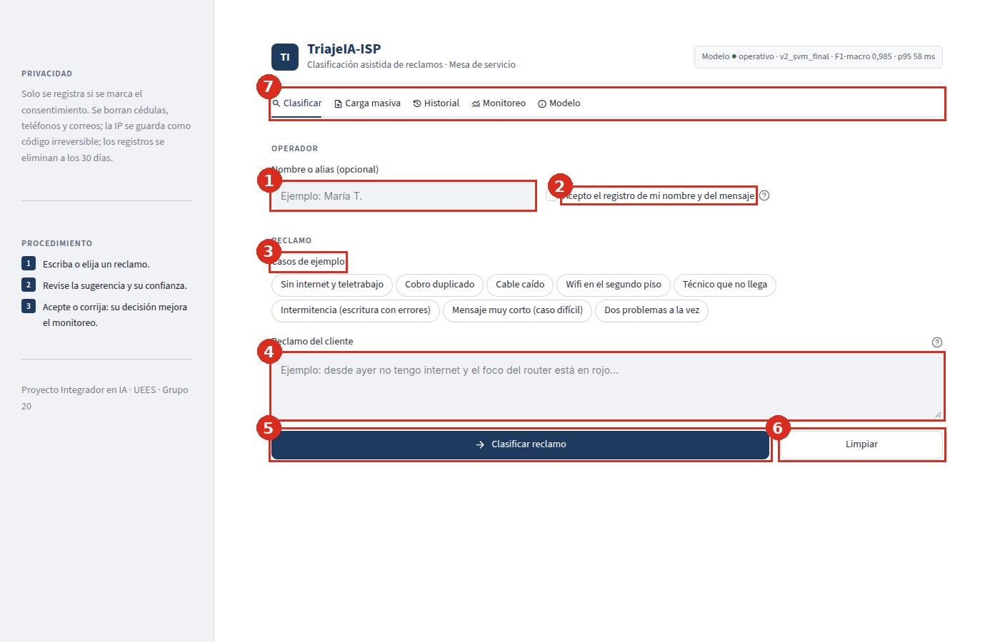

| # | Elemento | Para qué sirve |
|---|---|---|
| 1 | **Nombre o alias** | Opcional. Identifica quién clasificó, solo si se registra |
| 2 | **Consentimiento** | Si lo marca, la clasificación y su decisión se guardan para el monitoreo. Si no, la aplicación funciona igual pero no guarda nada |
| 3 | **Casos de ejemplo** | Botones que cargan un reclamo de prueba con un clic |
| 4 | **Reclamo del cliente** | Donde escribe o pega el texto del reclamo (máximo 2.000 caracteres) |
| 5 | **Clasificar reclamo** | Ejecuta la clasificación |
| 6 | **Limpiar** | Borra el texto y el resultado |
| 7 | **Pestañas** | Clasificar · Carga masiva · Historial · Monitoreo · Modelo |

El panel lateral resume la **privacidad** y el **procedimiento** en tres pasos.

## 2. Clasificar un reclamo

1. *(Opcional)* Escriba su nombre o alias y marque **«Acepto el registro…»** si quiere que la clasificación se guarde.
2. Escriba o pegue el reclamo **tal como lo envió el cliente**, con sus faltas o abreviaturas: el modelo está preparado
   para ellas. También puede elegir uno de los **casos de ejemplo**.
3. Pulse **Clasificar reclamo**. La respuesta tarda menos de un segundo.

> **No incluya** nombres, cédulas, teléfonos ni direcciones del cliente. Si se cuelan números de cédula, teléfono o
> correos, el sistema los reemplaza antes de guardar, pero no detecta nombres ni direcciones escritas.

Si el texto no se puede clasificar, aparece un aviso que explica qué corregir:

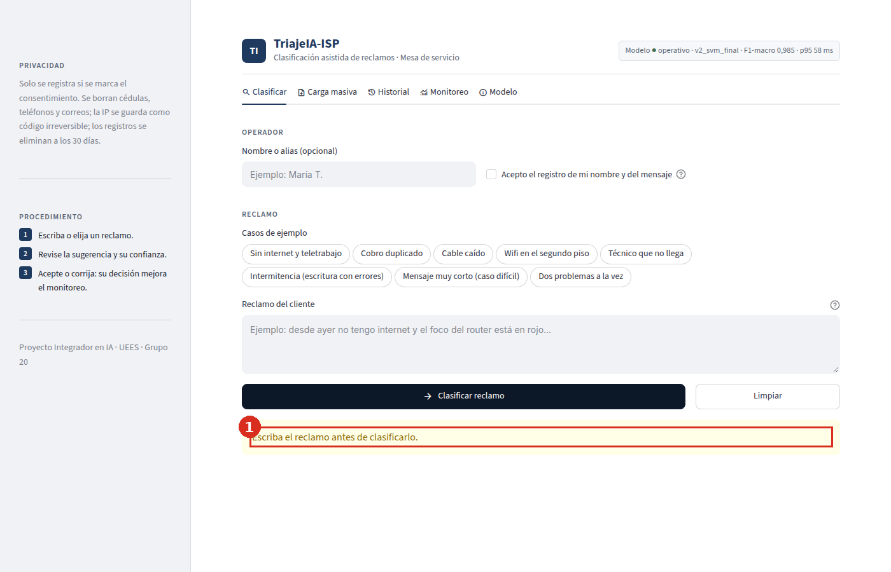

| Aviso | Qué hacer |
|---|---|
| «Escriba el reclamo antes de clasificarlo.» | El campo está vacío |
| «Describa el problema con al menos 3 palabras.» | El mensaje es demasiado corto |
| «El texto no contiene palabras…» | Solo hay números o emojis |
| «El texto es demasiado largo…» | Supera los 2.000 caracteres |

## 3. Entender el resultado

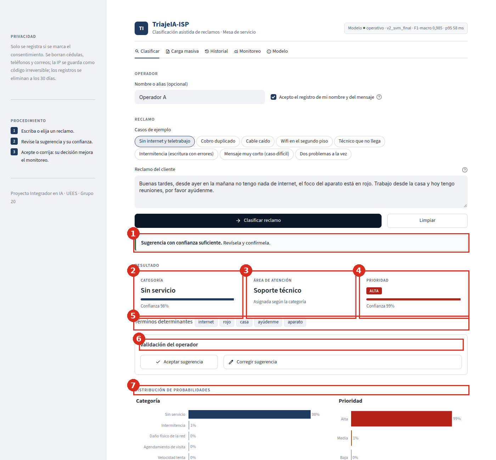

| # | Elemento | Cómo leerlo |
|---|---|---|
| 1 | **Aviso de estado** | Verde: la confianza es suficiente. Ámbar: requiere revisión humana (ver sección 5) |
| 2 | **Categoría** | El tipo de problema (por ejemplo, «Sin servicio»), con una barra de **confianza** de 0 a 100 % |
| 3 | **Área de atención** | El área que debe atender el reclamo. Se deduce de la categoría |
| 4 | **Prioridad** | ALTA (roja), MEDIA (ámbar) o BAJA (verde), con su confianza |
| 5 | **Términos determinantes** | Las palabras del reclamo que más pesaron en la categoría sugerida. Sirven para entender por qué el sistema sugirió eso |
| 6 | **Validación del operador** | Aceptar o corregir la sugerencia (ver sección 4) |
| 7 | **Distribución de probabilidades** | Qué tan probable considera el modelo cada categoría y cada prioridad. Si la segunda opción está cerca de la primera, el caso es dudoso |

**Categorías y áreas:**

| Categoría | Qué cubre | Área |
|---|---|---|
| Sin servicio | No hay internet en absoluto | Soporte técnico |
| Intermitencia | Se conecta y se cae | Soporte técnico |
| Velocidad lenta | Navega, pero lento | Soporte técnico |
| Wifi / equipo | Router, alcance del wifi, un dispositivo no conecta | Soporte técnico |
| Daño físico de la red | Cable caído o robado, poste, caja abierta | Planta externa |
| Facturación | Cobros, pagos no registrados, descuentos | Facturación y cobranzas |
| Instalación | Contrató y no le instalan, o la instalación quedó mal | Instalaciones |
| Agendamiento de visita | El técnico no llega o no le dan cita | Instalaciones |
| Atención al cliente | Mal trato, esperas, el bot no resuelve | Servicio al cliente |
| Cancelación / traslado / plan | Dar de baja, mudar o cambiar de plan | Servicio al cliente |

## 4. Aceptar o corregir la sugerencia

Esta opción aparece solo si marcó el consentimiento.

- **Aceptar sugerencia:** confirma que la categoría y la prioridad son correctas.
- **Corregir sugerencia:** se abre un formulario para elegir la categoría (1) y la prioridad (2) correctas; luego pulse
  **Guardar corrección** (3).

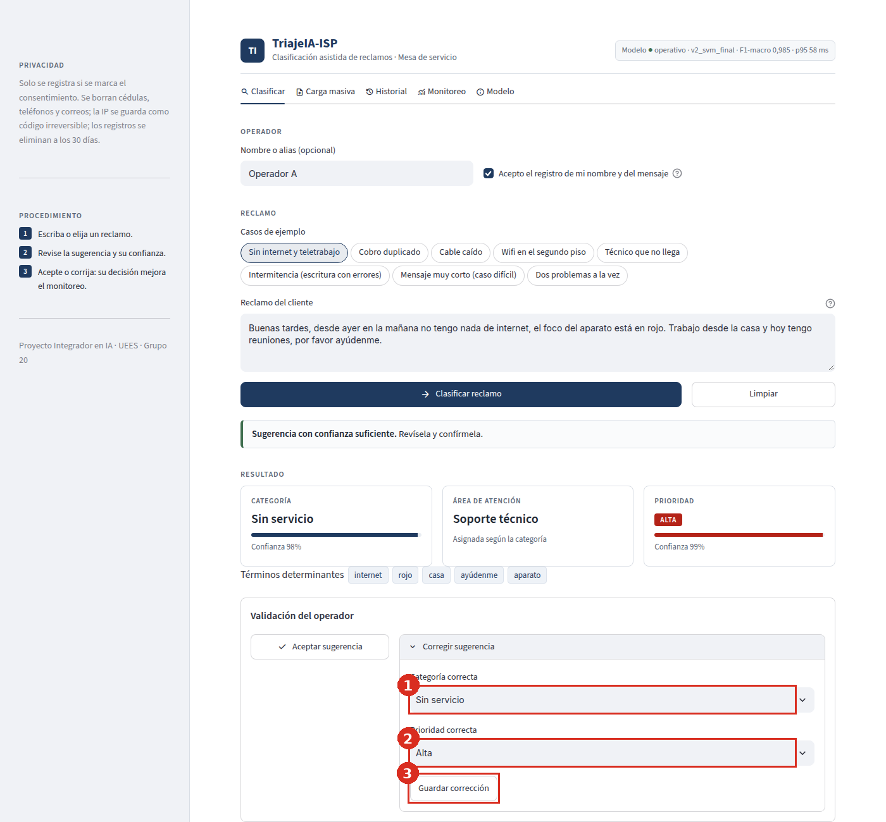

Sus decisiones no se usan para evaluarlo: sirven para medir qué tan bien funciona el modelo y en qué se equivoca.

## 5. Cuándo revisar con más cuidado

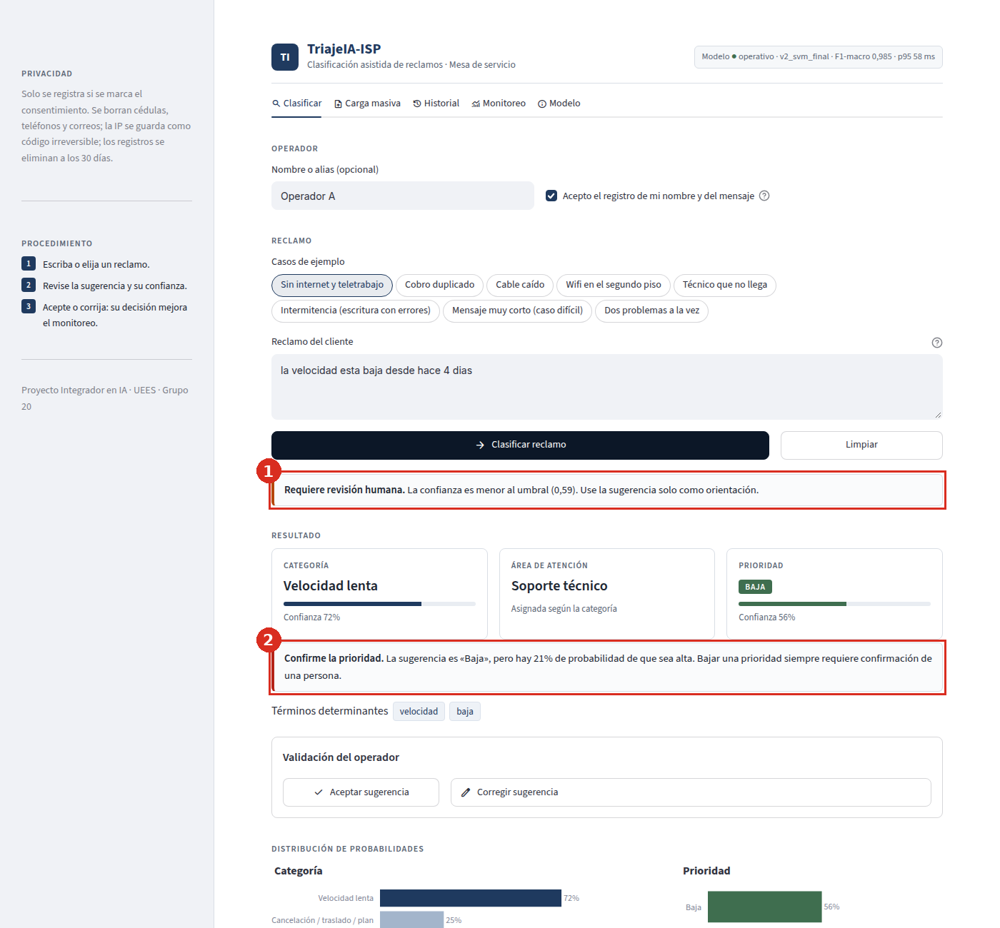

1. **«Requiere revisión humana»**: la confianza de la categoría o de la prioridad es menor que 0,59. Use la sugerencia
   solo como orientación y lea el reclamo con atención.
2. **«Confirme la prioridad»**: la prioridad sugerida es media o baja, pero hay 20 % o más de probabilidad de que sea
   alta. Antes de aceptar una prioridad más baja, confirme que el caso no es urgente.

**Ejemplo de la captura.** «la velocidad esta baja desde hace 4 dias» se sugirió con prioridad **baja**, aunque según la
guía de etiquetado la velocidad lenta nunca es prioridad baja (es media o alta). El sistema avisó con las dos alertas: así se evita que un error del
modelo pase sin revisión.

También conviene revisar con cuidado los **mensajes muy cortos o incompletos** y los que mencionan **dos problemas a la
vez**: son los casos en que el modelo se equivoca más.

## 6. Carga masiva (varios reclamos)

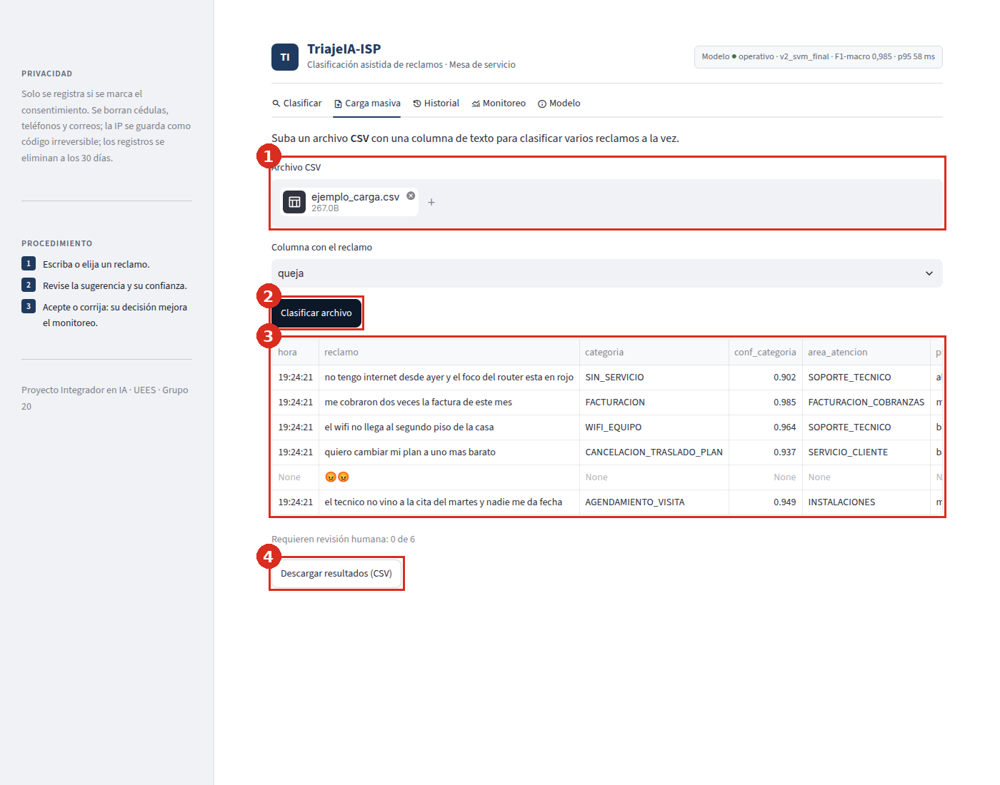

1. Prepare un archivo **CSV** (separado por comas, en UTF-8) con una columna de texto. Por ejemplo:

   ```csv
   queja
   no tengo internet desde ayer y el foco del router esta en rojo
   me cobraron dos veces la factura de este mes
   ```

2. Súbalo en **Archivo CSV** (máximo 5 MB; se procesan hasta 500 filas) y elija la **columna con el reclamo**.
3. Pulse **Clasificar archivo** (2). La tabla (3) muestra cada reclamo con su categoría, área, prioridad, confianza y
   alertas. Las filas que no se pueden clasificar aparecen con el motivo en la columna `error`.
4. Pulse **Descargar resultados (CSV)** (4) para guardarlos.

La carga masiva **no se registra** en la base de datos.

## 7. Historial de la sesión

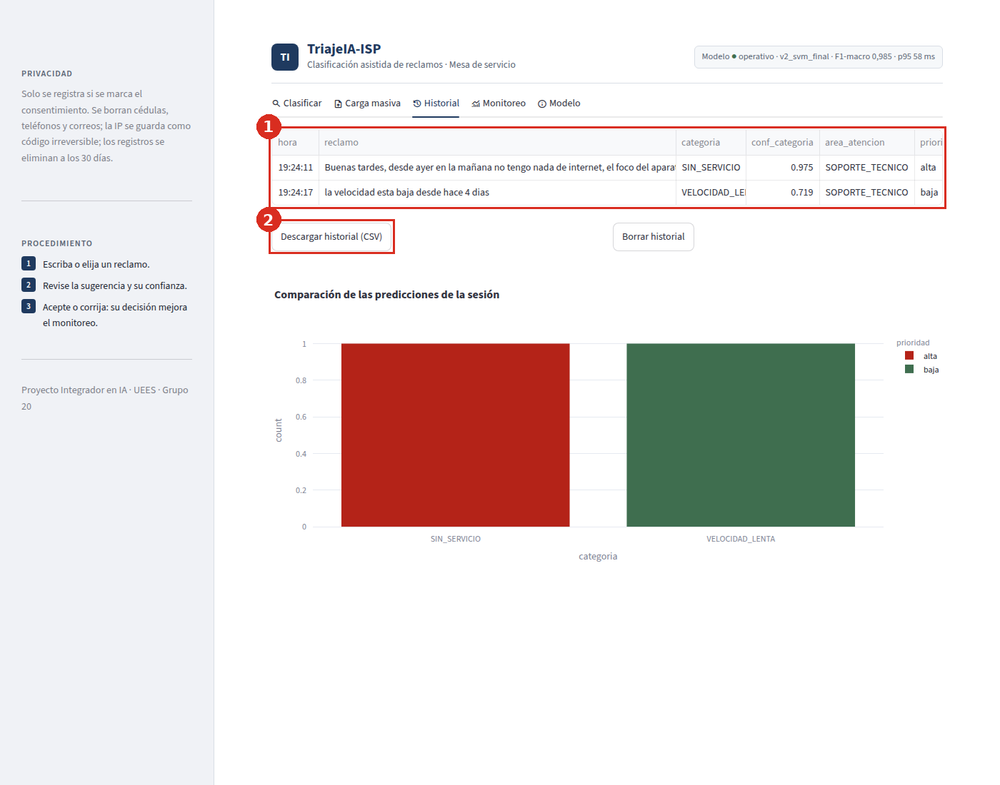

La pestaña **Historial** muestra las clasificaciones que hizo en esta sesión del navegador (1), con un gráfico
comparativo. Puede descargarlas (2) o borrarlas. El historial se pierde al cerrar o recargar la página.

## 8. Monitoreo (solo administradores)

Esta pestaña está protegida con contraseña, porque muestra los nombres y mensajes registrados.

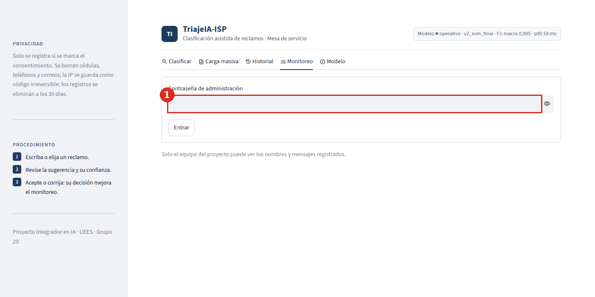

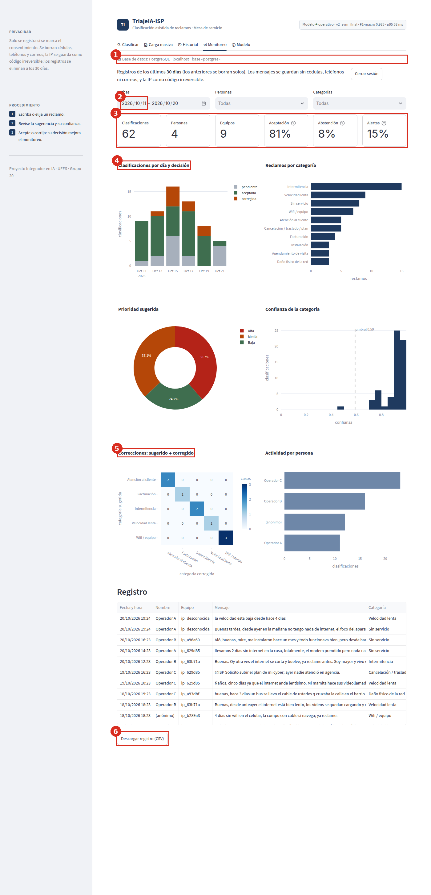

| # | Elemento | Para qué sirve |
|---|---|---|
| 1 | **Base de datos en uso** | Confirma dónde se guardan los registros (PostgreSQL en producción) |
| 2 | **Filtros** | Fechas, personas y categorías |
| 3 | **Indicadores** | Clasificaciones, personas, equipos, **aceptación** (meta ≥ 70 %), **abstención** (meta ≤ 15 %) y alertas de prioridad |
| 4 | **Gráficos** | Clasificaciones por día y decisión, reclamos por categoría, prioridad sugerida, confianza frente al umbral y actividad por persona |
| 5 | **Correcciones** | Qué sugirió el modelo y qué eligió la persona: muestra las confusiones reales |
| 6 | **Registro** | Tabla con cada clasificación y botón para descargarla en CSV |

Si la abstención supera el 15 %, la aceptación cae por debajo del 70 % o la abstención de la última semana sube 5
puntos o más, el panel muestra una **alerta**. Los registros se borran solos a los 30 días.

> En la captura, los nombres («Operador A», «Operador B»…) y los registros son ficticios, creados para este manual.

## 9. Información del modelo

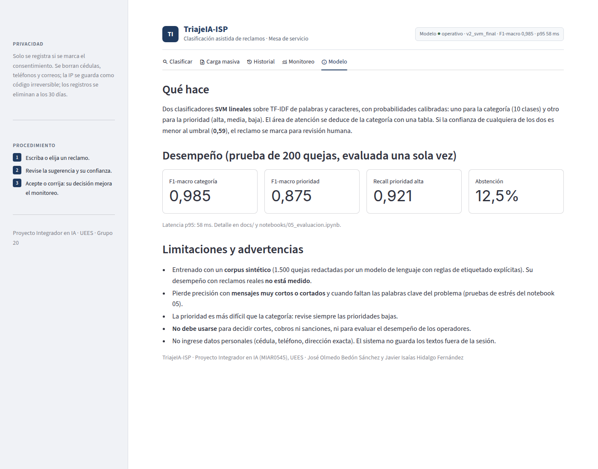

La pestaña **Modelo** explica qué hace el sistema, sus métricas en la prueba (F1-macro 0,985 en la categoría y 0,875 en
la prioridad) y sus **limitaciones y usos no permitidos**.

## 10. Uso en el celular

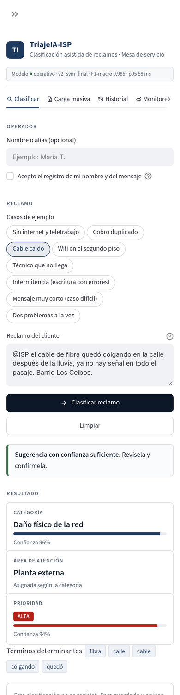

En el celular las secciones se apilan una debajo de otra. Las pestañas se deslizan de lado y el panel lateral se abre
con el botón **»** de la esquina superior izquierda.

## 11. Solución de problemas

| Problema | Solución |
|---|---|
| La página no carga o muestra «Your app is in the oven» | Espere uno o dos minutos y recargue; la aplicación puede estar despertando o actualizándose |
| Aparece un error con «ImportError» después de una actualización | Un administrador debe reiniciar la aplicación desde Streamlit Cloud (**Manage app → Reboot app**) |
| El botón «Aceptar sugerencia» no aparece | Marque el consentimiento **antes** de clasificar |
| «Esta clasificación no se registró: la base de datos no está disponible» | La clasificación funciona, pero no se guardó; avise al administrador |
| No puedo entrar al Monitoreo | Requiere la contraseña de administración; solicítela al equipo |
| El monitoreo indica «SQLite local» | La aplicación no está usando la base PostgreSQL y los registros se perderán al reiniciar; avise al administrador |
| El CSV no se lee | Verifique que esté separado por comas, en UTF-8 y que pese menos de 5 MB |
| La sugerencia es claramente incorrecta | Use **Corregir sugerencia**: esa información ayuda a mejorar el modelo |

## 12. Preguntas frecuentes

**¿El sistema decide por mí?** No. Solo sugiere; usted acepta o corrige.

**¿Guarda lo que escribo?** Solo si marca el consentimiento. En ese caso guarda su nombre (si lo escribe), el mensaje
sin cédulas, teléfonos ni correos, la sugerencia y su decisión, durante 30 días. La IP no se guarda: solo un código
irreversible.

**¿Por qué a veces dice «requiere revisión humana»?** Porque el modelo no está suficientemente seguro. Es una protección,
no un error.

**¿Funciona con faltas de ortografía o jerga?** Sí. Con quejas formales, informales, muy informales y con errores el
desempeño fue parecido. Con palabras en kichwa hubo muy pocos casos de prueba (5) para sacar conclusiones.

**¿Puedo clasificar reclamos en inglés o de otro tipo de servicio?** No está preparado para eso.

**¿Qué tan confiable es?** En la prueba con quejas sintéticas acertó el 98,5 % de las categorías y el 87,5 % de las
prioridades. Con reclamos reales **no se ha medido** todavía, así que revise siempre la sugerencia.

## 13. Contacto

| Integrante | Correo |
|---|---|
| José Olmedo Bedón Sánchez | jose.bedon@uees.edu.ec |
| Javier Isaías Hidalgo Fernández | javier.hidalgo@uees.edu.ec |

Proyecto Integrador en Inteligencia Artificial (MIAR0545) · Universidad de Especialidades Espíritu Santo (UEES).
