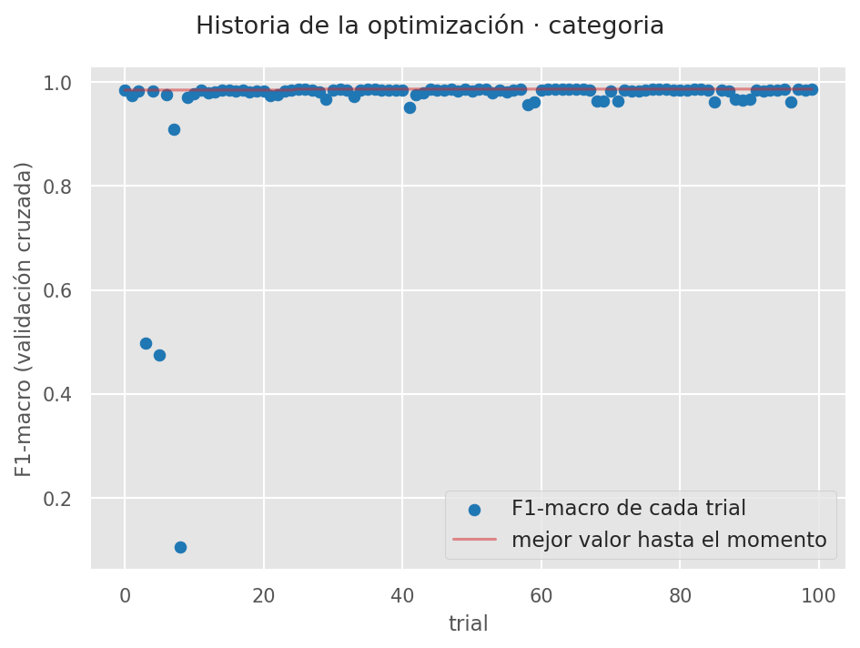
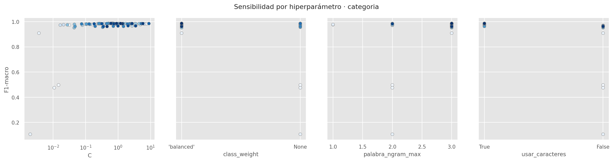
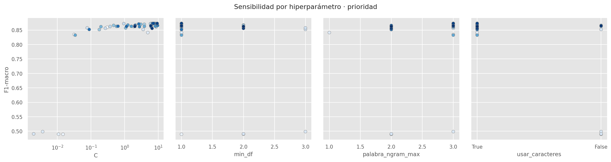
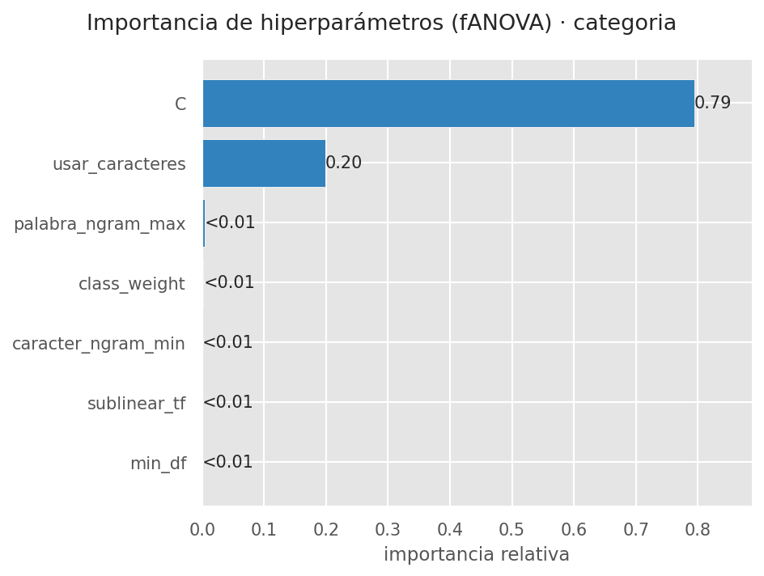
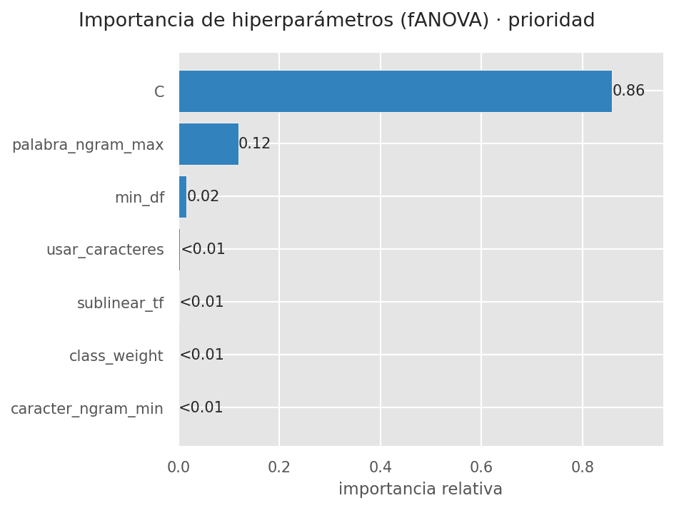
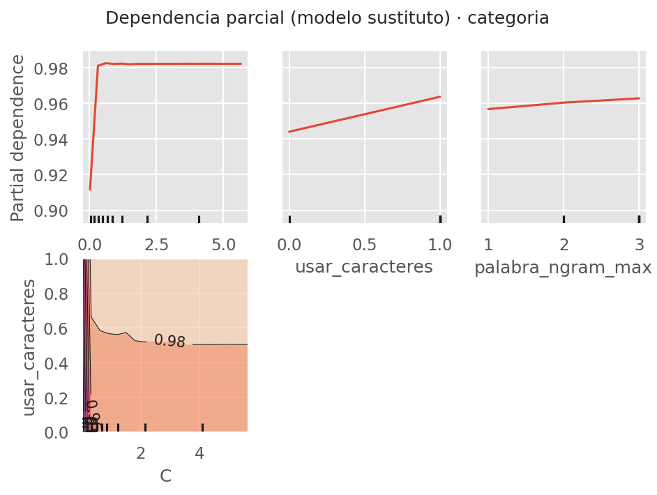
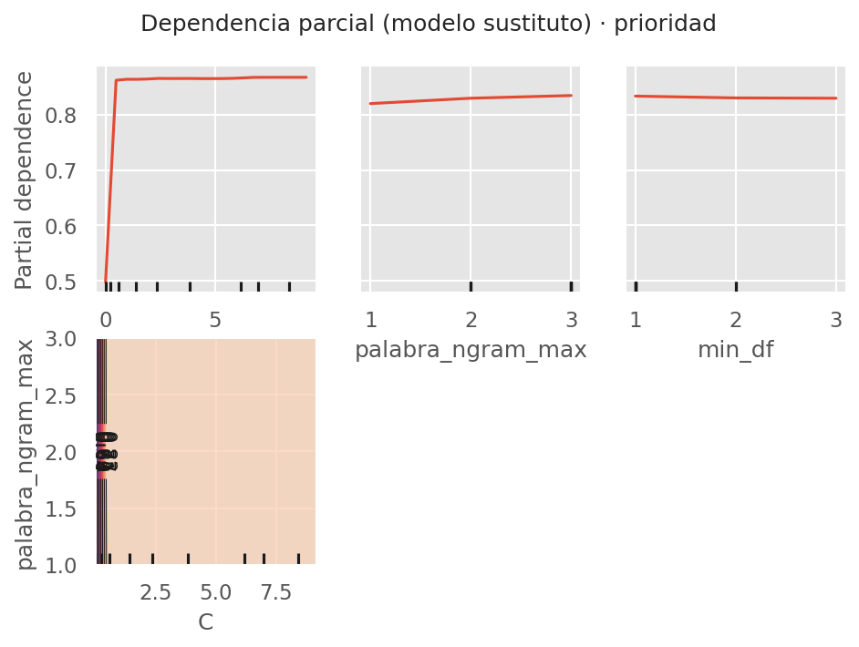
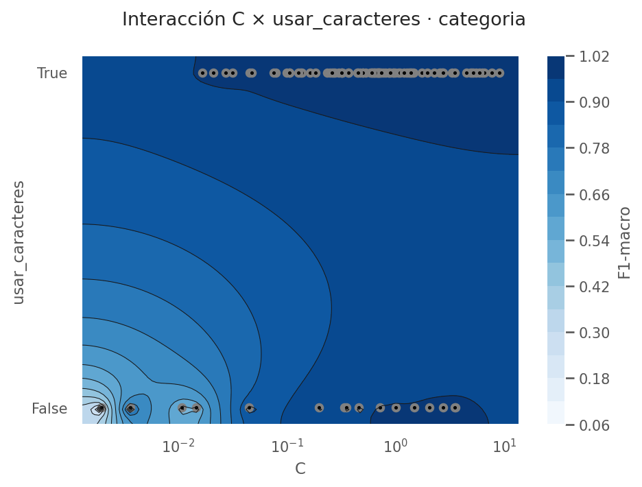
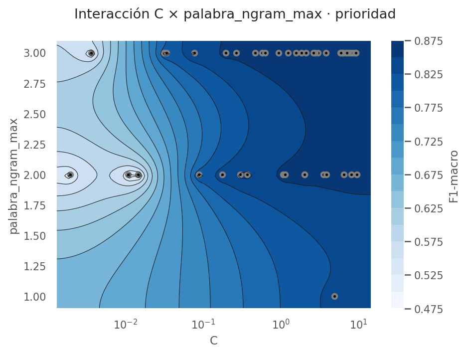
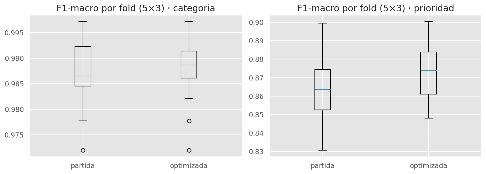

# Optimización de hiperparámetros

Proceso del Workshop de la Semana 5 aplicado a TriajeIA-ISP. Ejecución en Google Colab el 20/10/2026
([`notebooks/04_optimizacion.ipynb`](../notebooks/04_optimizacion.ipynb)); cifras en
[`results/metrics/04_optimizacion.json`](../results/metrics/04_optimizacion.json) y los *trials* completos en
`results/metrics/04_trials_*.csv`.

## 1. Método

| Aspecto | Decisión |
|---|---|
| Herramienta | **Optuna**, búsqueda bayesiana con TPE y semilla fija (42) |
| Modelo | SVM lineal (`LinearSVC`) sobre TF-IDF de palabras y caracteres |
| Datos | Los 1.300 textos de desarrollo (entrenamiento + validación). **La prueba no se usa** |
| Métrica | F1-macro con validación cruzada estratificada de 5 *folds* |
| Presupuesto | 100 *trials* para la categoría y 50 para la prioridad |
| Punto de partida | El *trial* 0 es la configuración de partida (la mejor de la Semana 3, C = 0,3), encolada a propósito para que compita en igualdad de condiciones |
| Regla de adopción | La configuración optimizada se adopta solo si mejora en una validación cruzada repetida 5 × 3 **fuera del margen de error** |

Para que cada *trial* fuera rápido se puntuó la SVM sin calibrar; la calibración de probabilidades, que se aplica en
el modelo final, no cambia la clase predicha salvo en empates.

## 2. Hiperparámetros explorados y rangos

| Hiperparámetro | Rango | Qué controla |
|---|---|---|
| `C` | 0,001 – 10 (escala logarítmica) | Regularización: valores bajos simplifican el modelo (riesgo de subajuste); altos lo ajustan más a los datos |
| `palabra_ngram_max` | 1 – 3 | Usar palabras sueltas, pares o tríos de palabras |
| `usar_caracteres` | sí / no | Agregar fragmentos de letras, que toleran erratas y variaciones |
| `caracter_ngram_min`, `caracter_ngram_max` | 2 – 3 y hasta 6 | Tamaño de esos fragmentos |
| `min_df` | 1 – 3 | Descartar términos que aparecen en muy pocos textos |
| `sublinear_tf` | sí / no | Atenuar las palabras repetidas en un mismo texto |
| `class_weight` | `balanced` / ninguno | Compensar las clases con menos ejemplos |

## 3. Resultados del análisis de sensibilidad

| Objetivo | F1 de los *trials* (mín. – máx.) | Partida (*trial* 0) | Mejor *trial* | *Trials* a ≤ 0,005 del mejor |
|---|---|---|---|---|
| Categoría | 0,106 – 0,986 | 0,985 | 0,986 | 70 de 100 |
| Prioridad | 0,489 – 0,873 | 0,860 | 0,873 | 14 de 50 |

**Lectura.** En la categoría, la superficie es una **meseta**: 70 de 100 configuraciones quedan a menos de 0,005 del
mejor resultado, así que casi cualquier configuración razonable funciona y elegir entre ellas por diferencias tan
pequeñas sería sobreajustar la búsqueda. En la prioridad la meseta es más estrecha (14 de 50) y la configuración
importa más.

## 4. Ranking de importancia de hiperparámetros

Importancia calculada con fANOVA (`optuna.importance.FanovaImportanceEvaluator`, semilla 42):

| Hiperparámetro | Categoría | Prioridad |
|---|---|---|
| `C` | **0,794** | **0,859** |
| `usar_caracteres` | 0,198 | 0,004 |
| `palabra_ngram_max` | 0,004 | 0,119 |
| `min_df` | 0,000 | 0,017 |
| `class_weight` | 0,002 | 0,001 |
| `sublinear_tf` | 0,000 | 0,001 |
| `caracter_ngram_min` | 0,001 | 0,000 |

**Lectura.** `C` explica casi toda la variación en ambos objetivos. Después vienen los fragmentos de caracteres para la
categoría (en promedio, los *trials* que los usan obtienen 0,983 frente a 0,847 sin ellos) y los tríos de palabras para
la prioridad. Los demás hiperparámetros se pueden fijar sin pérdida.

## 5. *Partial dependence plots*

Como en el taller, se entrenó un modelo sustituto (`RandomForestRegressor`) que predice el F1 de un *trial* a partir de
sus hiperparámetros, y se graficó la dependencia parcial de los más importantes.

**Lectura.** En ambos objetivos la curva de `C` sube bruscamente con valores muy bajos y luego **se aplana**: por
debajo de ~0,01 la regularización es tan fuerte que el modelo queda demasiado simple (subajuste); desde ~0,1 en la categoría y
~1 en la prioridad, aumentar `C` ya no cambia el resultado. Esto coincide con la Semana 3, donde en el benchmark se
observó subajuste con C ≤ 0,01. Las curvas de `palabra_ngram_max` y `min_df` son casi planas.

## 6. Análisis de interacciones

- **Categoría (`C` × `usar_caracteres`):** sin fragmentos de caracteres hace falta un `C` más alto para llegar a la
  misma zona; con ellos, la zona buena empieza antes. Es una interacción débil: los fragmentos de caracteres compensan
  parte de la regularización.
- **Prioridad (`C` × `palabra_ngram_max`):** la zona más alta está en `C` ≥ 1 con tríos de palabras. Tiene sentido:
  la prioridad depende de expresiones de varias palabras («desde hace cinco días», «ya reclamé y nadie viene»).

## 7. Comparación antes y después

Validación cruzada repetida 5 × 3 con **los mismos *folds*** para ambas configuraciones (modelo calibrado completo);
IC 95 % por *bootstrap*.

| Objetivo | Partida | Optimizada | Diferencia (IC 95 %) | Decisión |
|---|---|---|---|---|
| Categoría | 0,987 ± 0,007 | 0,988 ± 0,006 | +0,000 [−0,002; +0,002] | **Sin evidencia de mejora: se mantiene la partida** |
| Prioridad | 0,864 ± 0,018 | 0,873 ± 0,014 | +0,010 [+0,004; +0,016]¹ | **Mejora con evidencia: se adopta la optimizada** |

¹ Intervalo guardado en `04_optimizacion.json`. El texto impreso en el notebook muestra [+0,005; +0,015] porque el
código vuelve a calcular el *bootstrap* al imprimir, con otros remuestreos. Ambos excluyen el 0, así que la conclusión
no cambia.

## 8. Configuración final y justificación

| Hiperparámetro | Categoría (partida) | Prioridad (optimizada) |
|---|---|---|
| `C` | 0,3 | 7,92 |
| N-gramas de palabras | 1 – 2 | 1 – 3 |
| Fragmentos de caracteres | 3 – 5 | 2 – 6 |
| `min_df` | 1 | 1 |
| `sublinear_tf` | sí | no |
| `class_weight` | balanced | balanced |
| Calibración | sigmoide, 5 *folds* | sigmoide, 5 *folds* |

Archivo: [`results/metrics/mejores_params_svm.json`](../results/metrics/mejores_params_svm.json). El modelo final
(`models/best_model.joblib`) se entrenó con los 1.300 textos de desarrollo usando estas configuraciones.

- **Categoría:** la mejor configuración de Optuna (C = 0,70 con tríos de palabras) supera a la de partida por
  +0,000 de media. Una diferencia así no justifica cambiar: se mantiene la configuración más simple y ya validada.
- **Prioridad:** la mejora de +0,010 es pequeña pero consistente (su intervalo no incluye el 0) y reduce además la
  variación entre *folds*.

## 9. Limitaciones

- Solo se optimizó la SVM. XLM-RoBERTa usó la configuración de la Semana 3 con parada temprana por F1-macro, porque
  cada entrenamiento cuesta 2 a 3 minutos de GPU y empató con la SVM (ver [`evaluacion.md`](evaluacion.md)).
- La meseta de la categoría es consecuencia del corpus sintético, cuyo vocabulario por categoría es muy claro; con
  reclamos reales la sensibilidad a los hiperparámetros probablemente sería mayor.
- El presupuesto (100 y 50 *trials*) es pequeño, pero suficiente para un espacio en el que un solo hiperparámetro
  explica el 79 % – 86 % de la variación.
